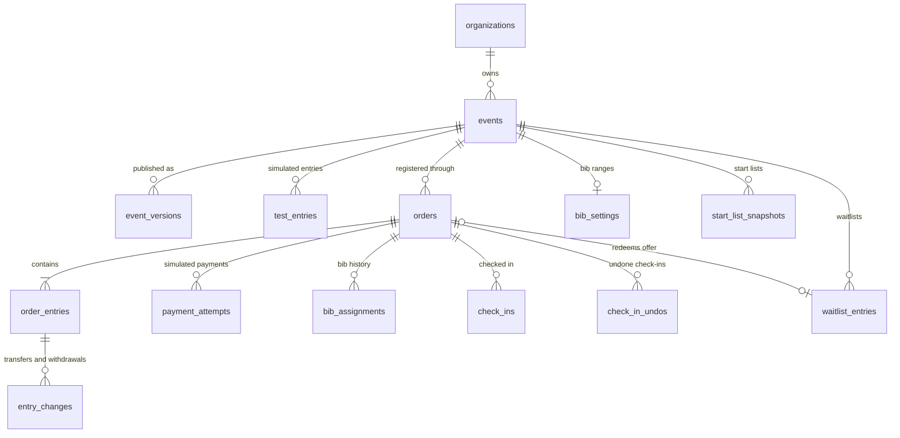
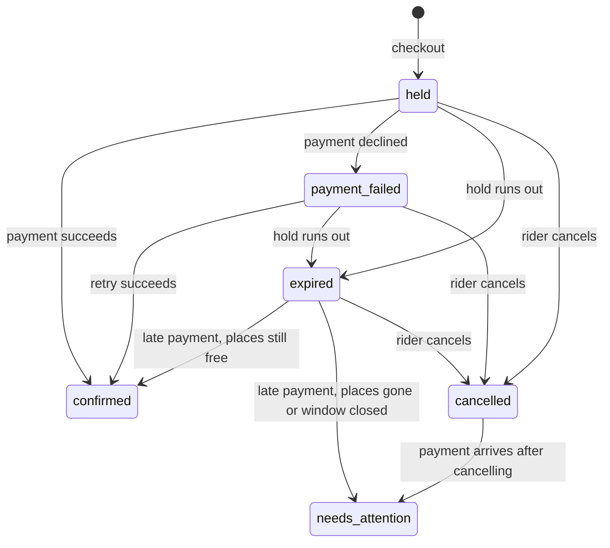

# Data model

This describes the database the local prototype uses today. It covers tables, relationships, important fields, constraints, and what happens when data is removed. The intended product data model, including entities that are not built yet, is in [product.md](product.md#data-model) and [product.md](product.md#data-storage).

**Status:** Implemented (local prototype). Describes schema version 7 (seven migrations) as of November 14, 2026.

**Source of truth:** the migrations in [src/server/db.ts](src/server/db.ts) and the event configuration schema in [src/shared/schema.ts](src/shared/schema.ts). If this file disagrees with them, the code wins; fix this file in the same change.

## Storage and migrations

- One SQLite file, `data/cyclereg.sqlite` by default (`DB_PATH` overrides it). The `data/` folder is ignored by Git.
- Opened with write-ahead logging (`journal_mode = WAL`), foreign keys enforced (`foreign_keys = ON`), and a 5-second busy timeout.
- Migrations are an ordered list of SQL strings in `MIGRATIONS` in [src/server/db.ts](src/server/db.ts). SQLite's `user_version` records how many have run. On startup each pending migration runs in its own transaction and bumps `user_version`. There are no down migrations; to start over, delete the database file.
- New migrations are appended to the end of the list. Never edit one that has already shipped, because existing databases will not rerun it.

| Migration | Adds |
|---|---|
| 1 | `organizations`, `events`, `event_versions`, `test_entries` |
| 2 | `orders`, `order_entries`, `payment_attempts` (checkout prototype, simulated payment) |
| 3 | `bib_settings`, `bib_assignments`, `check_ins` (race-day check-in prototype) |
| 4 | `start_list_snapshots` |

IDs are text generated by the application. Timestamps are ISO 8601 text. Money is stored in integer cents. Booleans are integers (0 or 1).

## Relationships

An organization owns events. Each event has one editable draft and any number of immutable published versions. Riders register through orders against one published version; each order holds one entry per category bought. Bibs, check-ins, and start-list snapshots belong to the event, and bibs and check-ins also point at the order (one order is one rider). `order_entries`, `bib_assignments`, and `check_ins` also carry `event_id` directly so they can be queried per event.

Races, race days, categories, start groups, display groups, and capacity pools are **not tables**. They live inside the event configuration JSON (see [Event configuration](#event-configuration-json)). Columns such as `category_id`, `race_id`, and `day_id` refer to IDs inside that JSON and are not enforced by foreign keys.

## Tables

### organizations

| Column | Notes |
|---|---|
| `id` | Primary key |
| `name` | Required |
| `created_at` | |

### events

The working draft of an event and a pointer to its current published version.

| Column | Notes |
|---|---|
| `id` | Primary key |
| `organization_id` | Required; references `organizations`. Indexed (`events_by_org`) |
| `draft_json` | The full draft [event configuration](#event-configuration-json) |
| `revision` | Starts at 1; increases on every save. A save must send the revision it started from, or it is refused with "changed somewhere else" (stale-save protection) |
| `published_version` | Latest version number in `event_versions`, or null if never published |
| `published_revision` | Draft revision that was published, used to tell whether the draft has unpublished changes |
| `created_at`, `updated_at` | |

### event_versions

Immutable published snapshots. Riders always register against one of these, never the draft.

| Column | Notes |
|---|---|
| `event_id`, `version` | Composite primary key; `event_id` references `events`. Versions count up from 1 |
| `config_json` | Copy of the draft configuration at publish time |
| `draft_revision` | Draft revision that was published |
| `warnings_acknowledged` | Number of validation warnings the organizer acknowledged |
| `published_at` | |

Publishing is refused if validation finds errors, or warnings that were not acknowledged. Rows are only inserted, never updated.

### test_entries

Simulated entries for exercising capacity rules in the organizer workspace. No payment and no rider data.

| Column | Notes |
|---|---|
| `id` | Primary key |
| `event_id` | References `events`. Indexed |
| `category_id` | Category ID inside the event configuration |
| `rider_ref` | Opaque rider reference, so one rider counts once toward shared limits |
| `created_at` | |

Unique on (`event_id`, `category_id`, `rider_ref`): a rider can hold a category once.

### orders

A rider's checkout in the prototype. Payment is simulated; no money moves.

| Column | Notes |
|---|---|
| `id` | Primary key |
| `event_id` | References `events`. Indexed |
| `published_version` | The `event_versions` version the order was priced and checked against. Later edits to the event do not change it |
| `client_request_id` | Idempotency key from the browser. Unique per event, so a resubmitted checkout returns the same order instead of a duplicate |
| `status` | `held`, `payment_failed`, `confirmed`, `expired`, `cancelled`, or `needs_attention` (see [Order lifecycle](#order-lifecycle)) |
| `rider_json` | Rider details: name, email, phone, team, racing age, license category, type and number, competition class, collegiate division, emergency contact, and optional guardian. This is the only place rider personal data is stored |
| `waiver_json` | Waiver version, read and agreed flags, typed signature name, and whether the rider or a guardian signed |
| `quote_json` | Price breakdown shown at checkout, so the accepted price stays on record |
| `total_cents` | Order total |
| `hold_expires_at` | When held places are released (default 10 minutes after the order; `HOLD_MINUTES` overrides) |
| `check_in_code` | Set when the order is confirmed |
| `created_at`, `updated_at`, `confirmed_at` | |

There is no separate rider or account table. Each order carries its own copy of the rider's details.

### order_entries

One row per category in an order.

| Column | Notes |
|---|---|
| `id` | Primary key |
| `order_id` | References `orders` |
| `event_id` | References `events`. Indexed |
| `category_id` | Current category ID. Inside the order's published version, or a later one after a transfer |
| `rider_ref` | Opaque rider reference shared by all entries in the order |
| `status` | `held`, `confirmed`, `released`, or `withdrawn` (an organizer withdrew a paid entry; it no longer takes a place, races, or appears on start lists) |
| `original_category_id` | Category bought at purchase, set on the first transfer (null means unchanged). Used to find what was paid for the entry in `orders.quote_json` |
| `withdrawn_at` | When the organizer withdrew the entry |
| `license_reviewed`, `license_review_note`, `license_reviewed_at` | Organizer's manual license review. Defaults to not reviewed |

### entry_changes

Log of organizer transfers and withdrawals of paid entries (migration 6). The order's price is never changed; money differences are recorded here and settled outside the app while payments are simulated.

| Column | Notes |
|---|---|
| `id` | Primary key |
| `event_id`, `order_id`, `entry_id` | References `events`, `orders`, `order_entries`. Indexed by (`order_id`, `created_at`) |
| `kind` | `transfer` or `withdraw` |
| `from_category_id` | Category before the change |
| `to_category_id` | Category after a transfer; null for a withdrawal |
| `amount_paid_cents` | What the rider paid for this entry at purchase, after discounts |
| `new_price_cents` | Current price of the new category (transfers only) |
| `difference_cents` | `new_price_cents` − `amount_paid_cents`. Positive: the rider owes; negative: a refund is due |
| `reason` | Required organizer note |
| `created_at` | |

### payment_attempts

Each simulated payment result for an order.

| Column | Notes |
|---|---|
| `id` | Primary key. The payment attempt ID sent with the notification, so a repeated notification is recognized and returns the order unchanged |
| `order_id` | References `orders`. An attempt ID already recorded for a different order is refused |
| `outcome` | `success` or `failure` |
| `result_status` | Order status after processing it |
| `created_at` | |

### bib_settings

| Column | Notes |
|---|---|
| `event_id` | Primary key; references `events`. One row per event |
| `settings_json` | Bib scope (`weekend` or per day) and number ranges per scope |
| `updated_at` | |

### bib_assignments

Bib history. A changed bib is released with a reason, never deleted.

| Column | Notes |
|---|---|
| `id` | Primary key |
| `event_id` | References `events` |
| `scope` | `weekend`, or a race day ID when bibs are per day |
| `order_id` | References `orders` (the rider) |
| `bib` | Bib number |
| `assigned_at` | |
| `released_at`, `release_reason` | Null while the bib is active |

Two partial unique indexes apply only to active rows (`released_at IS NULL`): a bib number is used once per event and scope (`bib_active_number`), and a rider has one active bib per event and scope (`bib_active_rider`).

### check_ins

| Column | Notes |
|---|---|
| `id` | Primary key |
| `event_id` | References `events` |
| `order_id` | References `orders` |
| `day_id` | Race day ID inside the event configuration |
| `checked_in_at` | |

Unique on (`event_id`, `order_id`, `day_id`): one check-in per rider per day. A repeat check-in is ignored and the first one is kept.

### check_in_undos

Undone check-ins (migration 7). Undoing removes the `check_ins` row so the rider can be checked in again; this table keeps the record.

| Column | Notes |
|---|---|
| `id` | Primary key |
| `event_id`, `order_id` | References `events`, `orders` |
| `day_id` | Race day ID inside the event configuration. Indexed with `order_id` |
| `checked_in_at` | When the undone check-in happened |
| `bib` | Bib the rider held at the time, if any |
| `bib_released` | 1 if the bib was released; 0 if it was kept because it also covers another day the rider is still checked in for |
| `reason` | Required note |
| `undone_at` | |

A released bib's `bib_assignments.release_reason` reads "Check-in undone: <reason>".

### start_list_snapshots

Numbered start lists per race. Immutable once saved; later changes show as a difference from the previous snapshot.

| Column | Notes |
|---|---|
| `id` | Primary key |
| `event_id` | References `events` |
| `race_id` | Race ID inside the event configuration |
| `version` | Counts up per race; unique on (`event_id`, `race_id`, `version`) |
| `published_version` | Event version the snapshot was built from |
| `rows_json` | The start-list rows |
| `created_at` | |

### waitlist_entries

Organizer-managed waitlists (migration 5). A rider joins a full category whose waitlist is turned on; the organizer offers places in order. Policy: [product.md](product.md#3-capacity-and-entry-integrity).

| Column | Notes |
|---|---|
| `id` | Primary key |
| `event_id` | References `events` |
| `category_id` | Category ID inside the event configuration |
| `rider_json` | Name, email, racing age, license category and type, competition class, collegiate division. No emergency contact or guardian |
| `status` | `waiting`, `offered`, `accepted`, or `removed`. An `offered` row whose `offer_expires_at` has passed reads as `expired` (no background job) |
| `offer_token` | Random private link token, set when offered; unique |
| `offered_at` | When the organizer made the offer |
| `offer_expires_at` | `offered_at` + 24 hours |
| `order_id` | References `orders`; set when the rider starts checkout from the offer link |
| `created_at` | Join time; sets the order of the list (index on `event_id`, `category_id`, `created_at`) |
| `updated_at` | |

Paying for the offer's order sets `status` to `accepted`. Removing a rider withdraws any open offer.

## Event configuration (JSON)

`events.draft_json` and `event_versions.config_json` hold one document validated by `eventConfigSchema` in [src/shared/schema.ts](src/shared/schema.ts) (`schemaVersion: 1`). It contains:

| Part | Holds |
|---|---|
| `event` | Name, time zone, venue, demo flag and notice |
| `ruleSet` | Rule source and season |
| `registration` | Bundles, discounts, fees, and related settings |
| `days` | 1 to 7 race days |
| `races` | Up to 20 races, each on a day, road race or criterium |
| `displayGroups` | Up to 40 headers that group categories for display; they never set limits |
| `startGroups` | Up to 100, each in a race, with start and staging times and an optional field limit |
| `categories` | Up to 300; each has eligibility paths, pricing and price changes, a registration window, race length, classifications, a start group, an optional `waitlistEnabled` flag (off when absent), and a status of `active`, `closed`, or `archived` |
| `capacityPools` | Up to 50 shared limits over listed categories and start groups |

The Berkeley demo seeds $80 road race and $60 criterium base prices and a fixed $130 bundle (`priceCents: 13000`, `discountCents: 0`); the fixed price takes precedence over a discount amount. Existing drafts and published orders are not migrated.

Bundles may carry optional `omnium` metadata (`code`, `label`). When such a bundle applies, `orders.quote_json.bundle.omnium` snapshots those values, the two bundled category IDs, and `status: needs_review`. This records a podium nomination, not an awarded classification, additional entry, or clearance. It is provisional until the order is confirmed; cancelled, expired, or released orders do not represent entered packages. No nomination approval or results storage exists. Older bundles and quotes omit this optional metadata. Existing databases need no SQL migration.

The configuration is validated on every save. A save is also refused if it would make existing entries invalid, for example a cap lowered below the places already taken.

## Standalone Berkeley demo seed

`npm run seed:berkeley` uses the existing tables and schema. It creates the `Berkeley standalone events (local demo)` organization and two events, each with an immutable published version. Each event contains only its own race, day, categories, display groups, and start groups. No orders, rider records, test entries, or bundles are seeded. Prices are $80 for the road race and $60 for the criterium, with zero fees and surcharges. The organization and both published events are created in one immediate transaction. Reruns identify this organization by its reserved demo name and return its existing events without overwriting drafts or publishing new versions. Other data is preserved. No SQL migration is needed.

## Capacity and concurrency

- Places taken = test entries + confirmed order entries + held order entries whose order hold has not expired + live waitlist offers (`offered`, not expired) whose rider does not yet hold the place through a live order.
- Waitlist first: while a category with its waitlist on has a `waiting` row or a live offer, checkout refuses that category except through the offer link, and the public page reports it as full.
- Saving a draft, publishing, creating an order, and processing a payment each run in an immediate (write-locking) transaction. Two requests for the last place cannot both succeed; the second waits, then sees the place taken.

## Order lifecycle

A new order starts `held` and reserves its places. A successful payment confirms it and issues a check-in code. If the hold runs out, the order is treated as `expired` and its places are free again. A payment that arrives after expiry is confirmed only if every place is still free and registration is open; otherwise the order goes to `needs_attention` for an organizer. A payment for a cancelled order also goes to `needs_attention`, never a silent re-entry. Payment notifications for `confirmed` or `needs_attention` orders change nothing.

`expired` is mostly computed rather than stored: an order still stored as `held` or `payment_failed` reads as `expired` once `hold_expires_at` has passed, so no background job is needed. Entries in an expired order read as `released`. Cancelling or moving to `needs_attention` stores `released` on the entries.

## Deletion behavior

The prototype does not delete records except simulated test entries.

- **No cascades.** Foreign keys have no `ON DELETE` clause and enforcement is on, so deleting a parent row that still has children fails. The app has no endpoint that deletes organizations, events, versions, orders, payment attempts, bibs, check-ins, or snapshots.
- **Test entries** are the only rows deleted: the organizer's clear action deletes all of an event's `test_entries`.
- **Categories** are archived (`status: archived` in the configuration), not removed, so published versions and existing entries still resolve them. If an order's category is missing from its published version, it shows as "Removed category".
- **Orders** are never deleted. Cancelled and expired orders stay for history and stop counting toward capacity.
- **Bibs** are released with a reason, never deleted.
- **Published versions and start-list snapshots** are insert-only.
- **Resetting** means deleting the database file. Retention periods and deletion of rider personal data are not built; [product.md](product.md#data-storage) requires them before a pilot.

## Not in the database yet

These are in [product.md](product.md#data-model) but do not exist in the prototype: user accounts and sign-in factors, organizer roles and permissions, rider profiles separate from orders, guardian relationships as records, real payments and refunds, automated waitlist promotion, USA Cycling license and waiver checks, and an audit log.

## Planned expansion, not current schema

The [season-pass requirements](product.md#cross-organization-bundles-and-season-passes) require a common purchase linking components across organizations/events, participant approvals, accepted rule versions, and per-organization discount/revenue/refund allocations. Current `orders.event_id` and event-local `registration.bundles` cannot represent that purchase. Planned Stripe payment, refund, transfer, and payout references need distinct reconciliation state; successful payment does not mean an organizer has been paid. Reusable rider identity, scoped reporting, promotion redemptions, communications, and overall-participation decisions likewise need an explicit data design before implementation. No SQL migrations, constraints, state transitions, or stored data changed in this documentation update. The target requirements live in product.md; this file continues to describe the existing database above.

### Planned participant, bib, and credit extensions

[Participant management](product.md#participant-management) requires reusable rider identity plus organization/role-scoped history, saved views, record-action audits, and identity-correction safeguards; current orders still hold independent rider copies. [Automatic/bulk bib allocation](product.md#automatic-and-bulk-bib-assignment) must retain the existing active-number uniqueness and assignment history while adding stable batch previews, concurrency checks, and atomic application; no batch or automatic-allocation state is stored today. [Credits and deferrals](product.md#reusable-credits-and-deferrals) need an auditable balance ledger with issuance, reservation, redemption, release, expiry and restoration records, original payment allocations, issuing-organization/currency/restriction references, and linked source/destination decisions. These are target requirements only. No current database tables, migrations, constraints, or data behavior changed in this documentation update.
