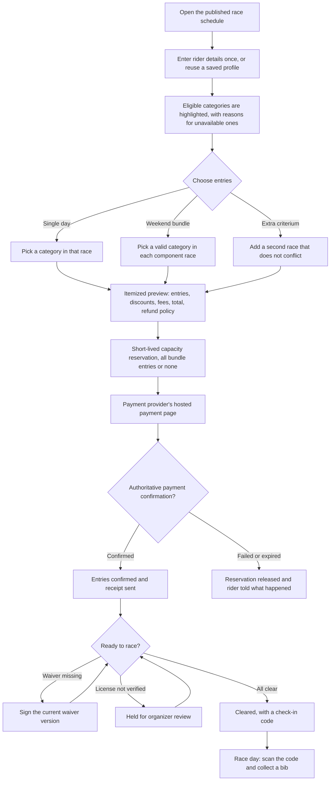
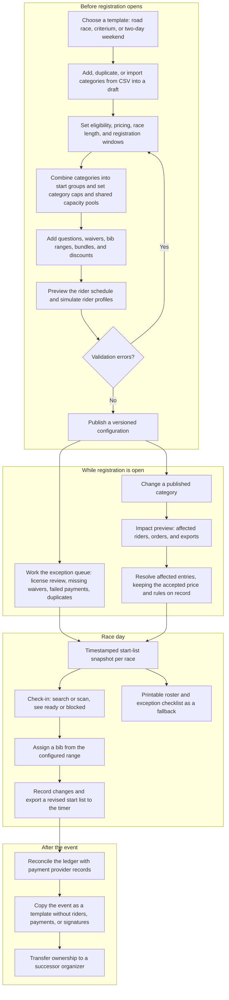
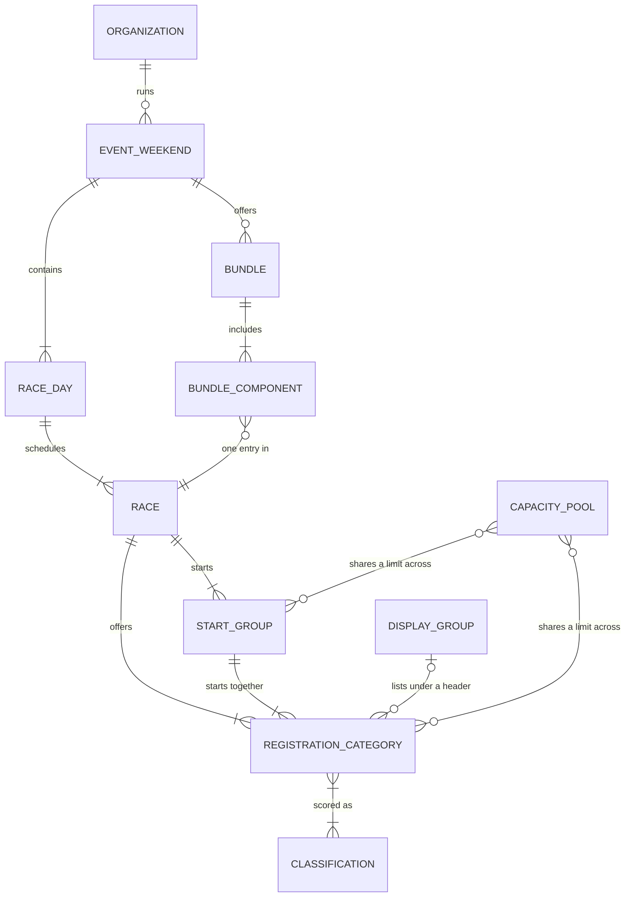

# CycleReg: registration and race-day operations for U.S. road races and criteriums

CycleReg (working name; availability not checked) is a proposed registration and race-day platform for volunteer-run U.S. bike races. Its first release targets road races, criteriums, and two-day road race plus criterium weekends. The goal is measurable: less volunteer time spent on setup, registration exceptions, check-in, and handing the event to next year's organizer.

> **Status: documentation only.** This repository holds the product brief, roadmap, and contributor guides. There is no application code, no payment processing, no USA Cycling connection, and no deployed website. Roadmap Phase 0 (establishing the case to build) has not started.

## Who it serves and the problem it solves

Small race committees run multi-race weekends with a handful of volunteers. Riders have to pick the right field, understand what they are paying for, finish their paperwork, and collect a bib. Organizers have to keep fields, payments, waivers, and start lists correct across several races and days. When something goes wrong, the fix is manual work for a few people, often on race morning.

CycleReg proposes a guided cycling workflow: categories modeled the way road and criterium fields actually work, one prioritized exception queue, a fast ready-or-blocked check-in screen, and event templates a successor can reuse.

| User | What they need from CycleReg |
|---|---|
| Race director | Correct categories, limits, fees, and exports with little manual reconciliation |
| Registration lead | One prioritized exception queue with the reason and next action |
| Check-in volunteer | Fast lookup and an unmistakable ready or blocked result |
| Rider or parent | Clear fields, total cost, requirements, receipt, and check-in instructions |
| Timer or official | Reliable start lists with stable identifiers in an agreed format |
| Club treasurer | Entries, refunds, fees, and payouts that trace to one ledger |
| Successor organizer | Reusable setup, role access, history, and an operating guide |

Berkeley Omnium (Berkeley Bicycle Club) is the reference scenario and proposed first design partner. It is not an approved migration, and it stays on its current registration system until the launch criteria in [product.md](product.md#launch-criteria) pass.

## How it is meant to work

The three diagrams below describe **proposed** behavior from [product.md](product.md). None of it is built yet.

### 1. Rider registration journey

A rider can see the whole schedule before signing in. After entering their details once, they see which categories they qualify for and why others are unavailable. They can buy one race, a weekend bundle, or an extra criterium, and they see one itemized total before paying. Places are held briefly during checkout; a bundle holds every entry or none. Entries are confirmed only when the payment provider confirms payment. Paying does not by itself clear a rider to race: a missing waiver or an unverified license keeps them in a review state until it is resolved.

### 2. Organizer setup and race-day workflow

Setup happens in a draft. The organizer builds the category schedule, groups categories into start groups with explicit shared limits, previews what riders will see, and publishes only after validation passes. Once registration is open, the exception queue collects the work that needs a person. Any change to a published category shows who it affects before it takes effect, and paid entries keep the price and rules they were sold under. On race day, volunteers check riders in against a start-list snapshot, assign bibs, and send revisions to the timer, with a printed roster in case the connection fails. Afterwards the treasurer reconciles the money, and the event can be copied and handed to a successor.

### 3. How weekends, races, categories, and capacity relate

This is a proposed conceptual model, not a database schema. An organization runs event weekends; each weekend has race days, and each day has races. Within a race, six concepts stay separate so that one setting never changes another by accident:

- Registration category: what a rider buys, such as Masters 35+ Cat 3/4, with its own eligibility and price.
- Start group: the categories that start together under one field limit.
- Classification: the code the timer uses for scoring, so two masters age groups can share a start and still be scored separately.
- Display group: a heading on the schedule. It controls layout only and never creates a limit.
- Capacity pool: an explicit limit shared across chosen categories or start groups.
- Bundle: one purchase, such as a road race plus criterium weekend entry, with one entry in each component race. The rider picks a valid category for each day.

Full definitions are in [product.md](product.md#keep-the-concepts-separate).

## First-release scope

Planned for the first release (see [product.md](product.md#scope-of-the-first-release)):

- Event and weekend setup, including the road race and criterium category builder (P0)
- Mobile-friendly rider registration with guardian entry, waivers, and license review status
- Short-lived capacity reservations and atomic enforcement of shared limits
- Organizer workspace with search, exception filters, audited corrections, and roles
- Race-day check-in, bib assignment, start-list snapshots, and timer exports
- Hosted payments, partial refunds, and a reconciliation report

Out of scope at first: timing hardware, results and omnium points scoring, rankings, other cycling disciplines, international federations, event discovery, fundraising, offline check-in sync, and a native mobile app.

## Project status and next milestone

| Item | Status |
|---|---|
| Product brief and roadmap | Drafted; proposed, not approved |
| Repository and contributor documentation | Implemented November 14, 2026 |
| Technology stack | Not chosen; see [open decisions](docs/decisions/README.md#decision-backlog) |
| Application code, payments, USA Cycling integration, hosting | None |

**Next milestone: Phase 0 exit gate.** Phase 0 shows whether a specific, recurring volunteer workload problem exists and whether a custom product has a credible advantage over improving the current setup. If it does not, the roadmap says to stop the build. The first actions are in [roadmap.md](roadmap.md#next-actions).

## Documentation

| Document | What it covers |
|---|---|
| [product.md](product.md) | Source of truth for requirements, scope, flows, business rules, and acceptance criteria |
| [roadmap.md](roadmap.md) | Source of truth for phases, priorities, dependencies, risks, and delivery status |
| [CONTRIBUTING.md](CONTRIBUTING.md) | How to propose, make, and review a change |
| [docs/architecture.md](docs/architecture.md) | Proposed architecture, constraints, and open technical questions |
| [docs/coding-guide.md](docs/coding-guide.md) | Category and capacity modeling, eligibility, pricing, payments, privacy, accessibility, testing |
| [docs/documentation-guide.md](docs/documentation-guide.md) | How docs are organized, status vocabulary, glossary, and setup and troubleshooting templates |
| [docs/content-guide.md](docs/content-guide.md) | Rules for future public pages, including SEO, answer engines, and structured data |
| [docs/decisions/README.md](docs/decisions/README.md) | Architecture decision records and the backlog of unresolved decisions |

## Contributing

Read [CONTRIBUTING.md](CONTRIBUTING.md) first. Every change must review both [product.md](product.md) and [roadmap.md](roadmap.md) for impact and say in its summary what changed in each, or why neither needed to change.

## License

Not chosen yet. Until a license is added, no reuse rights are granted.
