# CycleReg: registration and race-day operations for U.S. road races and criteriums

CycleReg (working name; availability not checked) is a proposed registration and race-day platform for volunteer-run U.S. bike races. Its first release targets road races, criteriums, and two-day road race plus criterium weekends. The goal is measurable: less volunteer time spent on setup, registration exceptions, check-in, and handing the event to next year's organizer.

> **Status: local build of the organizer category builder, rider checkout, registration tools, and race-day check-in.** You can build a road race and criterium weekend, publish it, register as a rider for one day or both (bundle pricing, held places, and a **simulated** payment), manage entries, check riders in, and download start lists and CSV exports, all on your own computer. Every organizer page and checkout requires passwordless email sign-in (Clerk), and each person's role in an organization (owner, registration manager, check-in volunteer, timer/export, finance) limits what they can see and change. Real payments, USA Cycling license and waiver checks, and multi-factor authentication (MFA) for organizer roles are **not built** and are shown as pending in the app. Until organizer MFA ships, use fictional data only; the app is not deployed. Phase 0 discovery tools are written. One discovery interview has been run; no measurements have been done.

## Who it serves and the problem it solves

Small race committees run multi-race weekends with a handful of volunteers. Riders have to pick the right field, understand what they are paying for, finish their paperwork, and collect a bib. Organizers have to keep fields, payments, waivers, and start lists correct across several races and days. When something goes wrong, the fix is manual work for a few people, often on race morning.

CycleReg proposes a guided cycling workflow: categories modeled the way road and criterium fields actually work, one prioritized exception queue, a fast ready-or-blocked check-in screen, and event templates a successor can reuse.

| User | What they need from CycleReg |
|---|---|
| Race director | Correct categories, limits, fees, and exports with little manual reconciliation |
| Registration lead | One prioritized exception queue with the reason and next action |
| Check-in volunteer | Fast lookup and an unmistakable ready or blocked result |
| Rider or parent | Clear fields, total cost, requirements, receipt, and check-in instructions |
| Timer or official | Reliable start lists with stable identifiers and clear revisions in the sample export |
| Club treasurer | Entries, refunds, fees, and payouts that trace to one ledger |
| Successor organizer | Reusable setup, role access, history, and an operating guide |

Berkeley Omnium (Berkeley Bicycle Club) is the reference scenario and proposed first design partner. It is not an approved migration, and it stays on its current registration system until the launch criteria in [product.md](product.md#launch-criteria) pass.

See [feature.md](feature.md) for a concise overview of implemented and planned features. Stripe hosted Checkout and organizer refunds are implemented locally in test mode ([ADR 0002](docs/decisions/0002-stripe-payments.md)); real-provider operating verification remains open and live payments are not enabled. Planned expansion includes communications, rider self-service, promotions, reporting, race-day registration, dedicated omnium/stage-race setup, and multi-organization season passes. The current UI's bundles are same-event packages only.

## What works today

The organizer workspace runs locally and is covered by automated tests. Screens below use the labeled demonstration weekend, which is example data, not an approved race schedule.

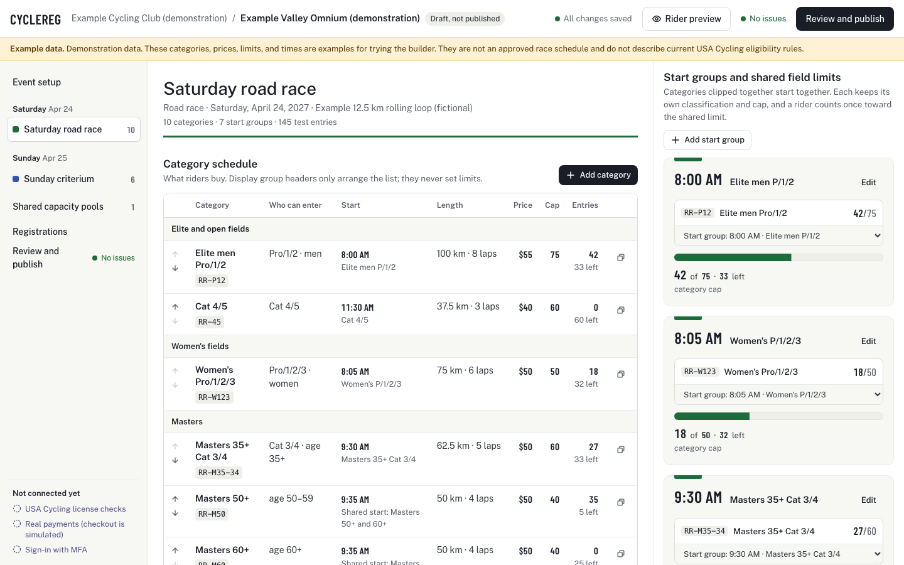

The category schedule lists what riders buy, grouped under display headers that never set limits. The field board on the right shows each start group as a clip of category tags with one tally for the shared field: Masters 50+ has 35 of its 40 places, and the combined 60-rider pool leaves 25 for Masters 60+.

| Organizer task | Status |
|---|---|
| Create an organization and a draft event from a road race, criterium, or two-day weekend template | Implemented |
| Create, duplicate (flagged for review), reorder, archive, and edit categories | Implemented |
| Eligibility by license category, license type, racing age, competition class, and collegiate path, with OR between paths | Implemented and tested |
| Prices with scheduled changes and day-of surcharge; registration windows | Implemented |
| Distance and laps, laps only, or minutes plus laps (for example 45 min + 3 laps) | Implemented and tested |
| Start groups that keep separate classification codes | Implemented and tested |
| Category caps, start group field limits, and shared capacity pools, with a rider counted once | Implemented and tested, including two simultaneous requests for the last place |
| Rider-facing schedule preview with an eligibility checker | Implemented |
| Validation that blocks publishing on errors; warnings need acknowledgement; only the reviewed draft publishes; immutable published versions | Implemented and tested |
| Autosave to a local PostgreSQL database, safe against stale saves | Implemented and tested |
| Rider demo purchase flow (product.md 2a): browse events, demo rider picker, start-ordered schedule with conflict warnings, bundles, second-race discount, demo fees, emergency contact, typed-name waiver signature, error summaries, all-or-nothing 10-minute holds, "Complete simulated payment" with decline and retry | Implemented and tested in light and dark themes; usability test with people still open |
| Confirmation with a check-in code and per-entry readiness; organizer Registrations queue with license review | Implemented and tested |
| Registration open and close times enforced in the event's time zone (demo events can let testers register early, labeled "Demo mode") | Implemented and tested |
| Race-day check-in: search by name, team, bib, or check-in code; ready/blocked result; bib ranges per event or day; bib history; repeat-safe check-in; undo a mistaken check-in with a reason; measured check-in times | Implemented; automated tests in CI; usability test with volunteers still open |
| Selected-rider bib preview and atomic apply in the check-in panel for confirmed, unassigned riders | Partly Implemented Phase 3 work; optional race/category scope and name, registration-time, or start-order sorting. Registration-manager permission required. Existing assignments are preserved, excluded riders show reasons, and changed choices require a fresh preview. Opt-in post-close automatic assignment is available under Bib ranges. Protected changes support explicit numbers or resequencing, require a reason and fresh preview, preserve history, and revise affected start lists; rehearsal remains Planned |
| Light and dark themes, following the system setting, with a header toggle | Implemented; shared input, focus, primary and secondary button, selected chip, category row, and check-in row contrast is checked in the browser. Keyboard, screen-reader, and real-phone passes are not done |
| Automated accessibility checks (WCAG 2.2 A and AA, axe-core) on the main screens in both themes | Implemented; run in CI. Keyboard, screen-reader, and real-phone passes not done |
| CSV import and export of category schedules, with column matching and per-row errors ([format](docs/csv-category-format.md)) | Implemented and tested |
| Start lists per race, numbered snapshots with changes since the last one, a start-list lock with revisions since the lock, and a sample timer CSV (format not yet agreed with a timer) | Implemented; automated tests in CI |
| Change-impact preview on Review and publish (affected categories, riders, orders; paid prices kept) | Implemented. The resolution workflow for affected entries is Implemented in the change resolution workflow row below |
| Organizer-managed waitlists: per-category setting, waitlist first, 24-hour offer links | Implemented; automated promotion and email delivery Planned |
| Organizer transfers and withdrawals of paid entries, with price differences logged | Implemented; automated tests in CI |
| Event summary on Registrations: riders, entries, unpaid holds, payment exceptions, license reviews to do, waitlist activity, per-category counts, and (for ledger roles) money that adds up to the ledger CSV | Implemented; automated tests in CI |
| Organizer refunds of an entry or an order, for simulated and Stripe test-mode payments (no real money moves) | Implemented; automated tests in CI. See [Phase 2](roadmap.md#phase-2--build-the-registration-core) for sandbox reconciliation progress |
| Refund and credit rules set by the organizer from templates (full refund until a deadline, tiered, credit only), shown to riders before paying and kept with each order | Implemented; a missing policy warning opens those rules in event setup. Whole-order policy preview in the organizer refund form, with refund amounts still entered by the organizer |
| Local reconciliation evidence CSV | Implemented locally, API and organizer download control; stored provider/payment/refund references and source states, no provider calls or settlement totals. [Requirements](product.md#reporting) |
| Finance summary CSV | Implemented locally November 26, 2026 as an owner/finance API export. Includes grouped registration counts and event-level ledger totals. [Requirements](product.md#reporting) |
| Atomic cancellation of reviewed plans | Implemented locally, simulation-only API and organizer controls; exact recovery, entry/refund/waitlist changes and durable closure; no provider/credit/message delivery |
| Cancellation execution financial preflight for a saved plan | Implemented locally, API only; simulation eligibility, no execution authority |
| Reviewed cancellation plan confirmation with fresh preview and actor/reason/acknowledgement evidence | Implemented locally, API and Registrations screen; no cancellation or financial execution |
| Cancellation operational impact preview: entries/holds, shared capacity, waitlists, saved snapshots and audience IDs | Implemented locally, API and owner/finance screen in Registrations; no execution |
| Paid cancellation allocation preview by event, current published race or day, keeping accepted prices and policies | Implemented locally, also shown in the operational preview; no cancellation or payout execution |
| Category builder: copy a day's races to another day, bulk edit with before/after preview | Implemented; automated tests in CI |
| Same-rider suggestions across orders, linked only when the organizer confirms | Implemented; automated tests in CI |
| Organizer CSV exports: entries and a simulated ledger, without contact details | Implemented; automated tests in CI |
| Registration lookup (name, email, team, order number, check-in code, whole license number, or active bib) and audited corrections of rider details with a required reason. Guardian fields on the order are not correctable yet ([open decision](product.md#guardian-correction-fields)) | Implemented; automated tests in CI. Each new correction records the signed-in organizer |
| Coupon codes: percentage or fixed, validity window, eligible categories, total cap held atomically, one per order and never stacked on another discount | Implemented; automated tests in CI. Per-rider limits Implemented (same-rider rule); combinability Planned |
| Per-category rider questions, waiver addenda, and bib ranges | Implemented; automated tests in CI |
| QR check-in code on the rider confirmation; camera scanning at check-in in Chrome and Edge | Implemented; live camera scan not yet checked |
| Change resolution workflow for paid entries affected by a published change | Implemented; automated tests in CI |
| Live payments and refunds with real money | Planned |

<details>
<summary>More screens: category editor, rider preview, publishing, rider checkout, registrations, phone layouts</summary>

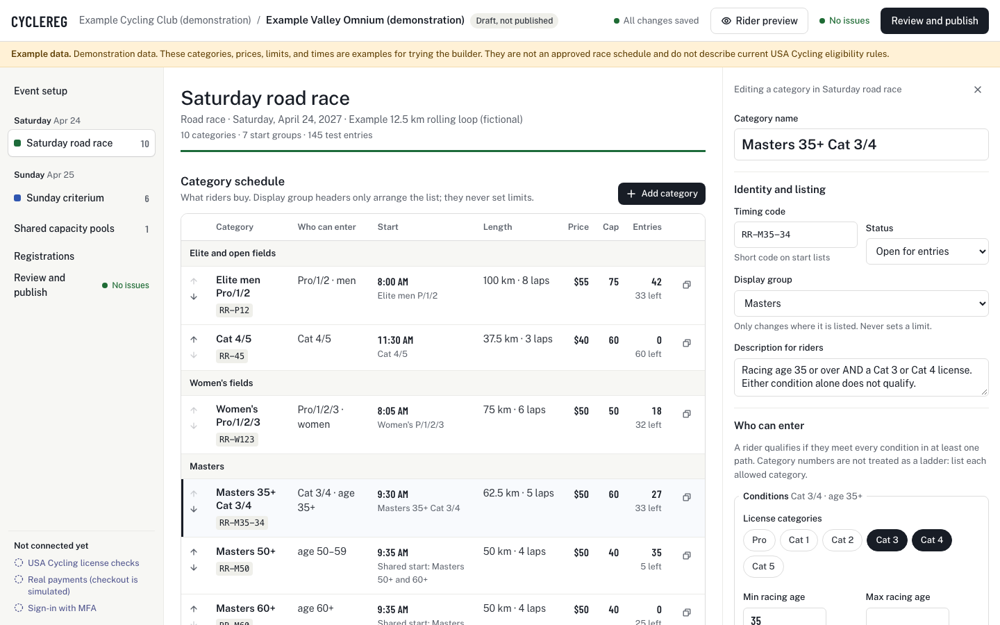

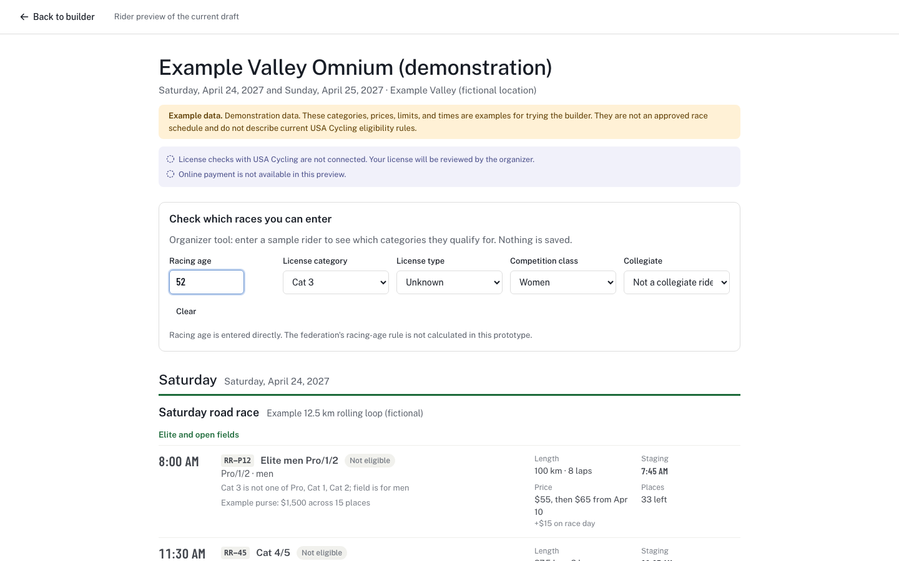

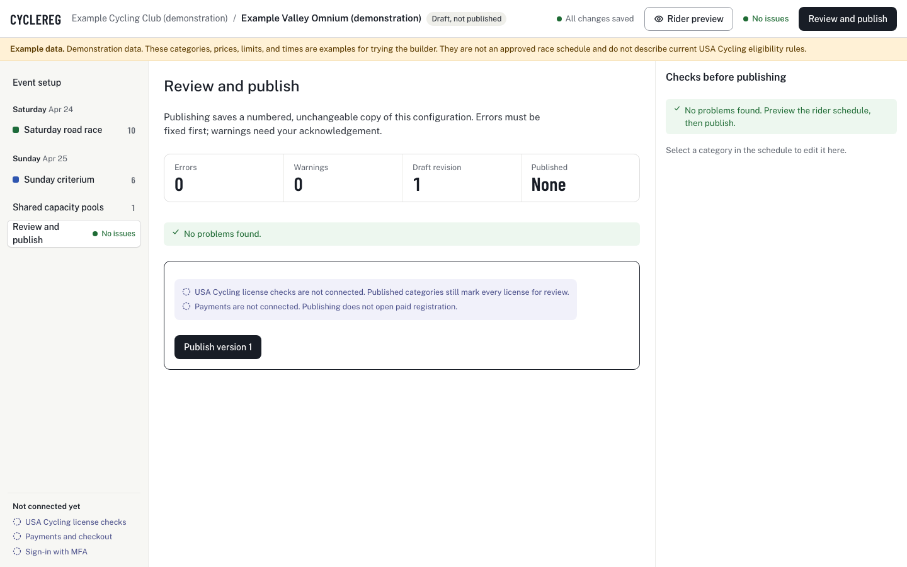

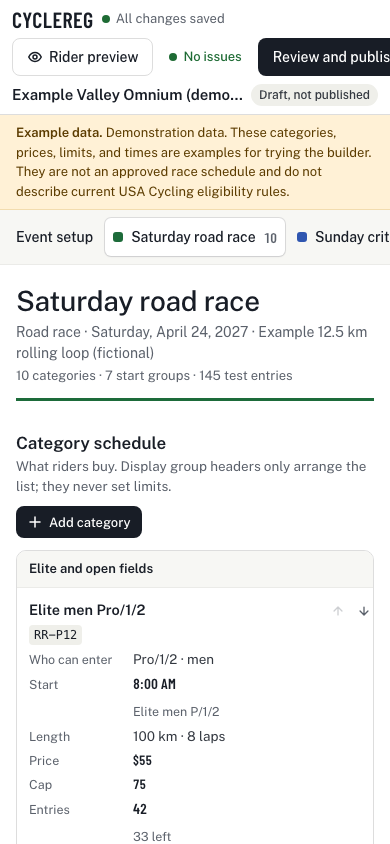

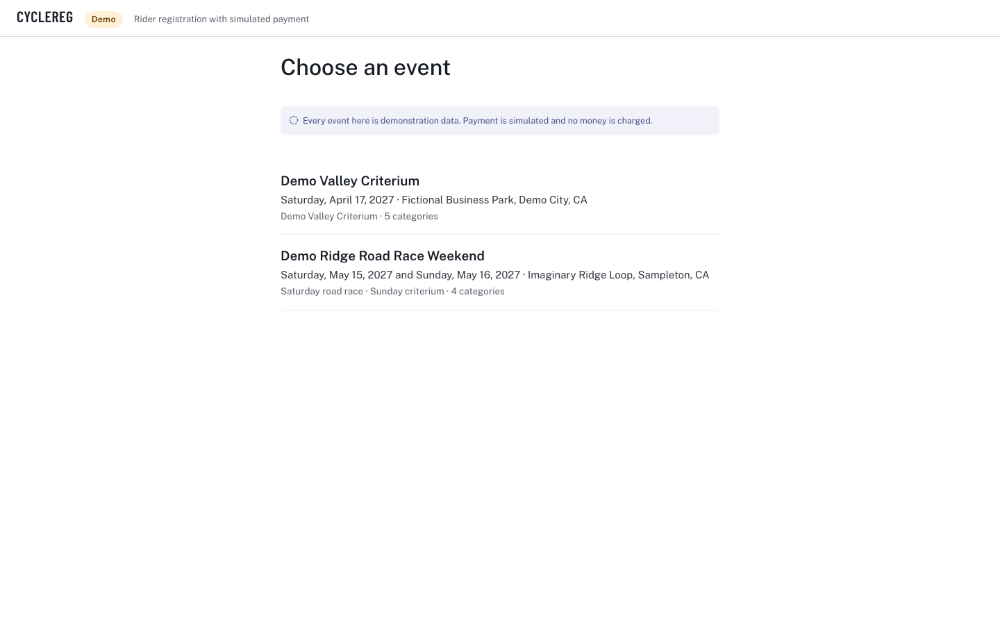

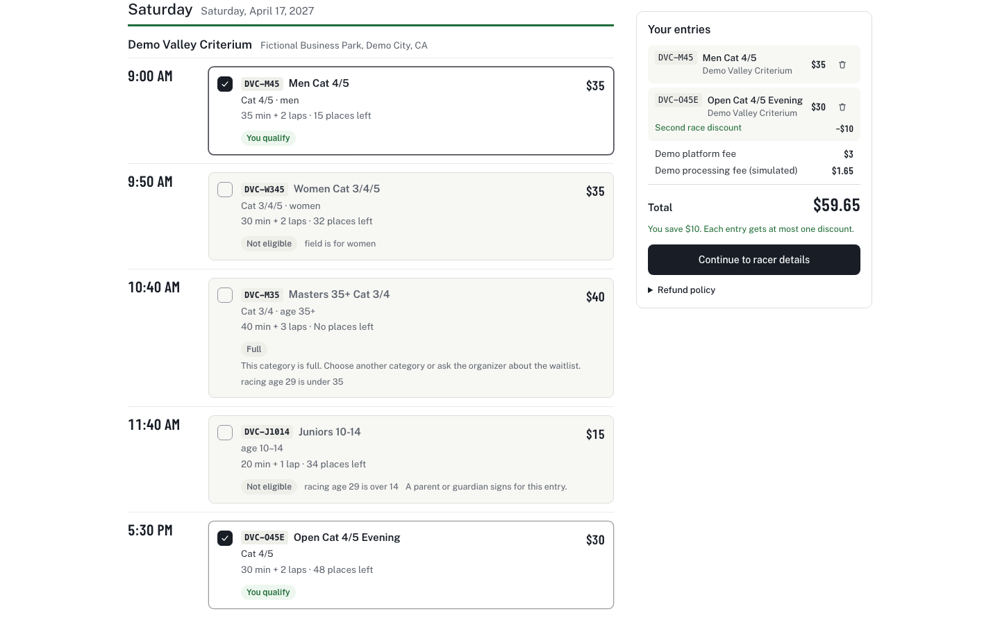

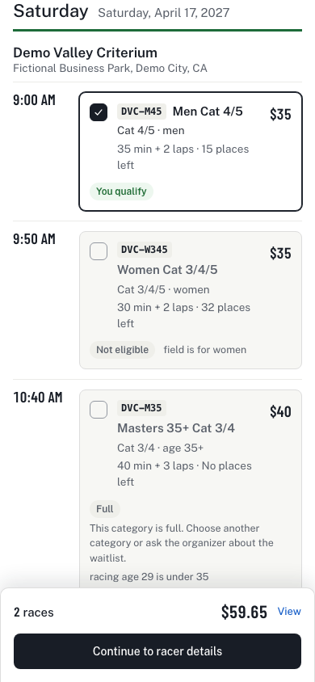

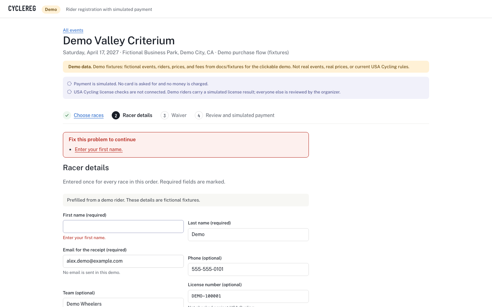

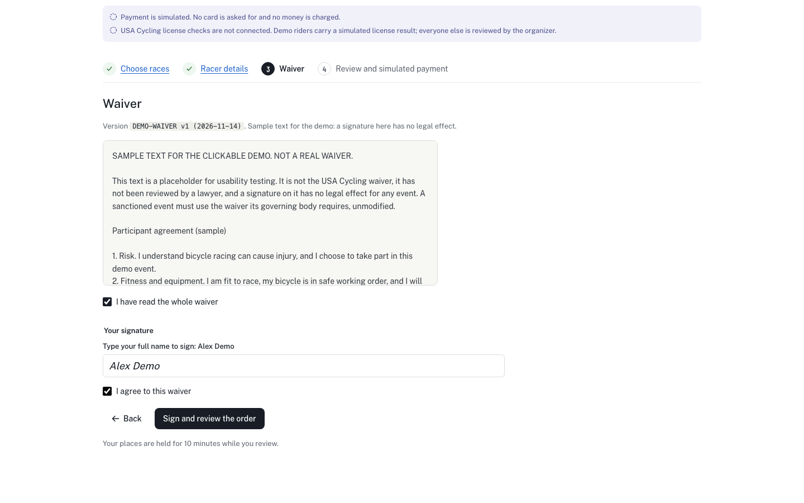

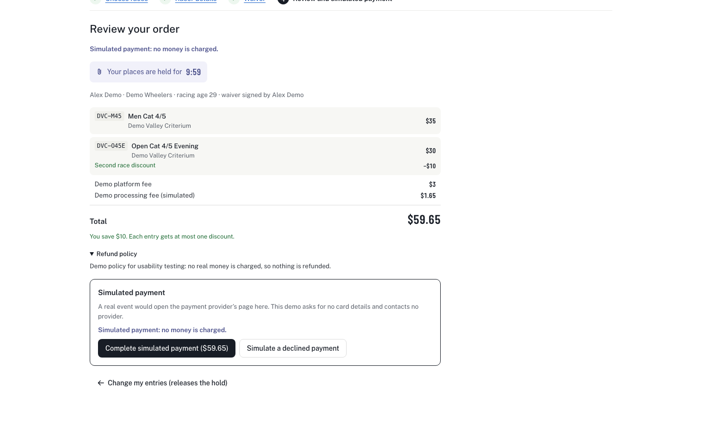

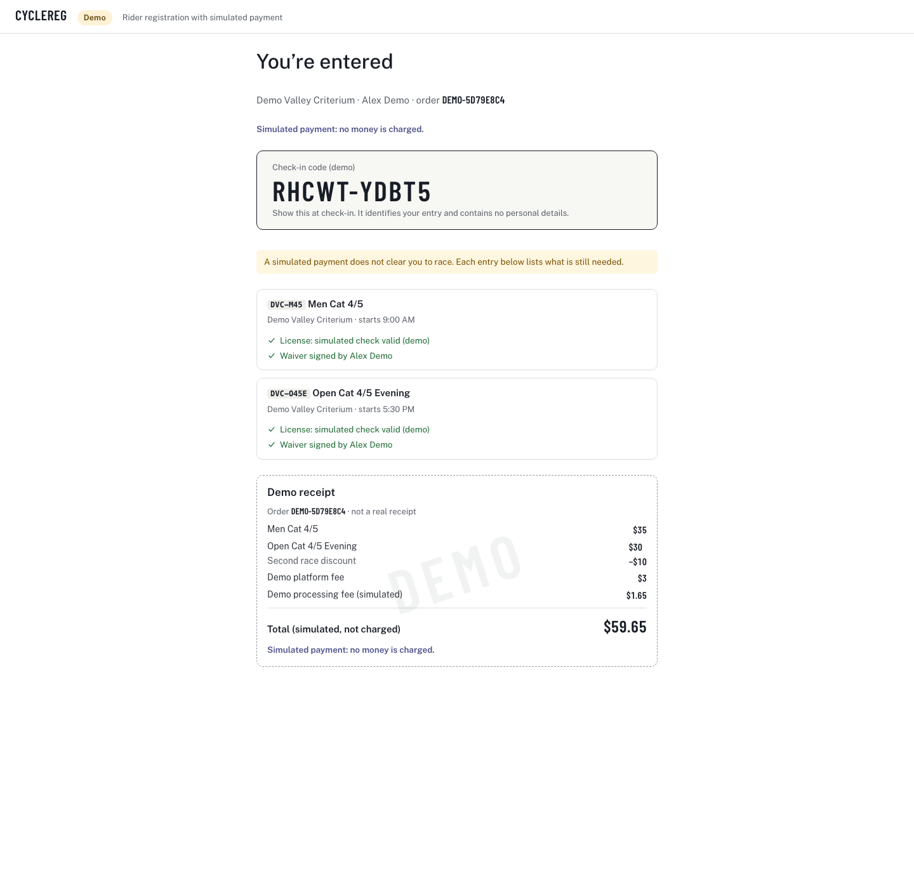

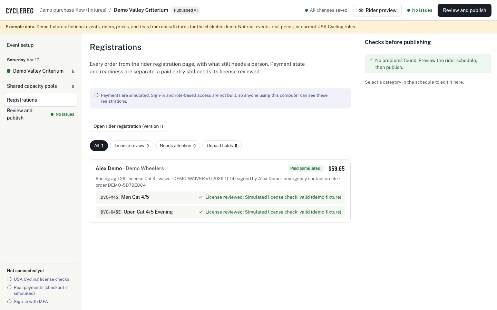

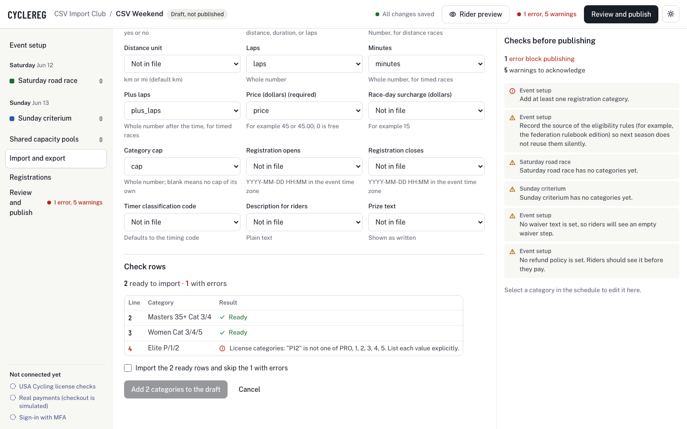

</details>

### Try it locally

You need Node.js 22 or later and a local PostgreSQL 17 database (Docker is the simplest way). Full steps and troubleshooting: [docs/runbooks/local-setup.md](docs/runbooks/local-setup.md).

```bash
docker run -d --name cyclereg-postgres -e POSTGRES_USER=cyclereg -e POSTGRES_PASSWORD=cyclereg -e POSTGRES_DB=cyclereg -p 127.0.0.1:5432:5432 postgres:17
```

```bash
npm ci
```

Local development needs no Clerk keys: without them, sign-in is a local test form for fictional `.test` addresses, refused in production and on network addresses. For real emailed sign-in, put `CLERK_SECRET_KEY` and `VITE_CLERK_PUBLISHABLE_KEY` in a local `.env` ([sign-in keys](docs/runbooks/local-setup.md#sign-in-keys)).

```bash
npm run dev
```

For one published Berkeley Omnium containing the road race ($80), criterium ($60), and $130 two-race package, follow [demo setup](SETUP.md) and run `npm run seed:berkeley -- --owner you@example.com` with the documented separate database.

BBC and Pinole team-time-trial cases load [published read-only research examples](SETUP.md#team-time-trial-read-only-research-examples). Team/TT registration is not implemented, so these records appear in the event chooser with registration unavailable.

Historical Wente, Mount Hamilton, Chico, and San Rafael Sunset setup cases and labeled local demos are available through [regional demo setup](SETUP.md#additional-northern-california-historical-demos). Their documented samples do not imply complete stage-race or official event admission.

For a three-round historical Red Kite criterium sample and the full-series case study, see [setup](SETUP.md#red-kite-historical-criterium-sample). It does not implement the full mixed-format calendar or season scoring.

For the historical San Francisco Grand Prix road-race demo, see [setup](SETUP.md#san-francisco-grand-prix-historical-demo). It uses the 2005 course with explicit test assumptions; individual checkout does not implement professional team admission.

For the historical Burlingame Criterium case study and published local demo, see [setup](SETUP.md#burlingame-historical-demo). The event is on hiatus; the demo uses the 2017 program and explicit test assumptions.

For deterministic road, criterium, omnium, empty, and large-event cases, run `npm run seed:cases -- --owner you@example.com`. Use `-- --list`, `-- --scenario <key>`, or `-- --reset` to inspect, load one case, or remove only the generated collection. See the [case-study fixture guide](docs/fixtures/README.md#generated-race-case-studies).

Open `http://127.0.0.1:5273/`, sign in with your email, and select **Load Berkeley Omnium** (the 2026 fields and times, dated for 2027, with organizer-set $80 road race and $60 criterium fees and a $130 two-race package including a podium nomination subject to organizer review), or create your own organization. Select **Browse rider events** to view already-published events; it does not load fixtures. For additional fictional testing data, use the [generated case-study collection](SETUP.md#generated-case-study-collection). Any event you publish also appears in the rider event list. For routine changes, run typechecking and the affected tests. Reserve `npm run check` and the full `npm run test:e2e` for phase completion, before deployment, or when the owner explicitly requests them ([test plan](docs/testing/test-plan.md)).

## How it is meant to work

The diagrams below describe behavior from [product.md](product.md). The rider journey is implemented with **simulated** payment; real payment confirmation is planned. In the organizer workflow, the "Before registration opens" steps are implemented, including category questions. The exception queue, check-in, start-list snapshots, sample timer export, and QR scanning are implemented. A live camera scan has not been checked. The after-event stages remain planned.

### 1. Rider registration journey

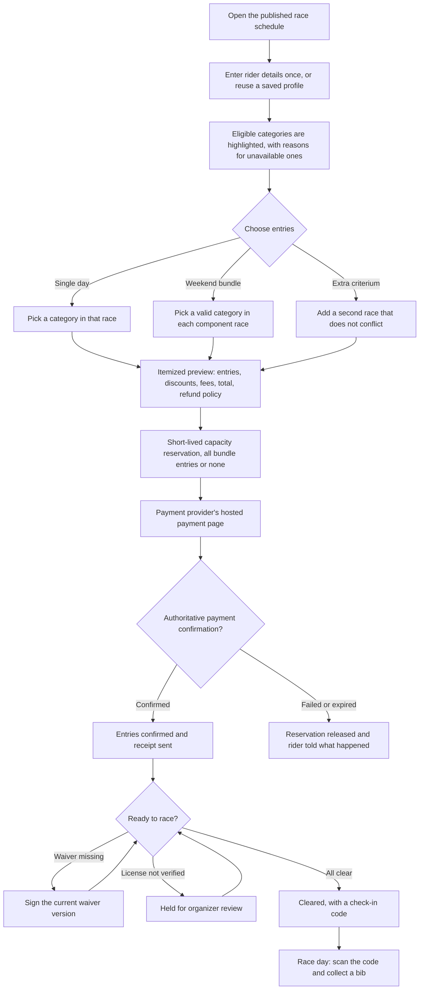

A rider can see the whole schedule before signing in. After entering their details once, they see which categories they qualify for and why others are unavailable. They can buy one race, a weekend bundle, or an extra criterium, and they see one itemized total before paying. Places are held briefly during checkout; a bundle holds every entry or none. Entries are confirmed only when the payment provider confirms payment. Paying does not by itself clear a rider to race: a missing waiver or an unverified license keeps them in a review state until it is resolved.

### 2. Organizer setup and race-day workflow

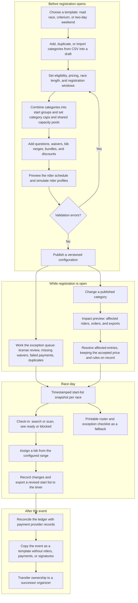

Setup happens in a draft. The organizer builds the category schedule, groups categories into start groups with explicit shared limits, previews what riders will see, and publishes only after validation passes. Once registration is open, the exception queue collects the work that needs a person. Any change to a published category shows who it affects before it takes effect, and paid entries keep the price and rules they were sold under. On race day, volunteers check riders in against a start-list snapshot, assign bibs, and send revisions to the timer, with a printed roster in case the connection fails. Afterwards the treasurer reconciles the money, and the event can be copied and handed to a successor.

### 3. How weekends, races, categories, and capacity relate

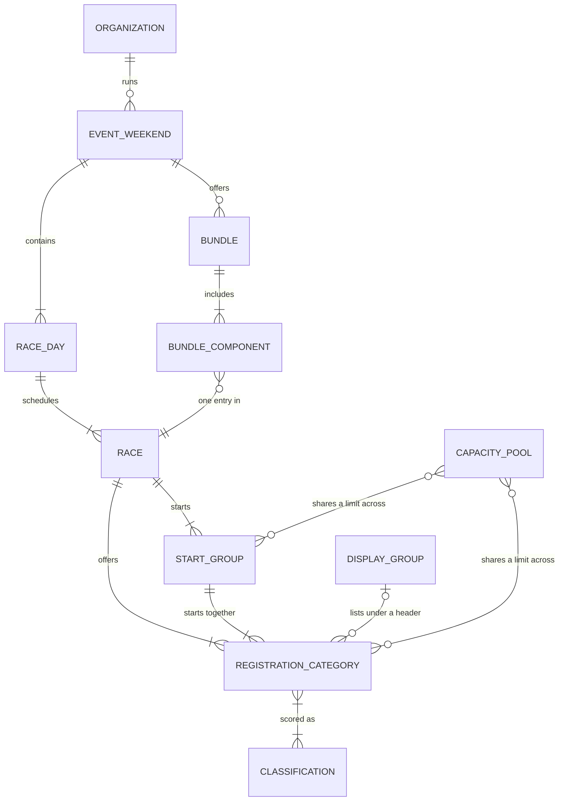

This is the conceptual model. It is implemented in the app's configuration document ([src/shared/schema.ts](src/shared/schema.ts)); bundles cover same-event packages only, and multi-event season passes are planned. An organization runs event weekends; each weekend has race days, and each day has races. Within a race, six concepts stay separate so that one setting never changes another by accident:

- Registration category: what a rider buys, such as Masters 35+ Cat 3/4, with its own eligibility and price.
- Start group: the categories that start together under one field limit.
- Classification: the code the timer uses for scoring, so two masters age groups can share a start and still be scored separately.
- Display group: a heading on the schedule. It controls layout only and never creates a limit.
- Capacity pool: an explicit limit shared across chosen categories or start groups.
- Bundle: one purchase, such as a road race plus criterium weekend entry, with one entry in each component race. The rider picks a valid category for each day.

Full definitions are in [product.md](product.md#keep-the-concepts-separate).

## First-release scope

Planned for the first release (see [product.md](product.md#scope-of-the-first-release)):

- Event and weekend setup, including the road race and criterium category builder (P0)
- Mobile-friendly rider registration with guardian entry, waivers, and license review status
- Short-lived capacity reservations and atomic enforcement of shared limits
- Organizer workspace with search, exception filters, audited corrections, and roles
- Race-day check-in, bib assignment, start-list snapshots, and timer exports
- Hosted payments, partial refunds, and a reconciliation report

Out of scope at first: timing hardware, results and omnium points scoring, rankings, other cycling disciplines, international federations, event discovery, fundraising, offline check-in sync, and a native mobile app.

## Project status and next milestone

| Item | Status |
|---|---|
| Product brief and roadmap | Drafted; proposed, not approved |
| Repository and contributor documentation | Implemented November 14, 2026 |
| Category builder milestone (local organizer build) | Implemented November 14, 2026; shared-cap, eligibility, and fixture criteria verified by automated tests. See [roadmap.md](roadmap.md#category-builder-milestone) |
| Rider checkout (simulated payment) | Implemented November 14, 2026; buy-both-days, payment retry, license uncertainty, multi-race discount, and bundle criteria verified by automated tests. See [roadmap.md](roadmap.md#rider-checkout) |
| Start lists and sample timer export | Implemented November 14, 2026; see [roadmap.md](roadmap.md#start-lists-and-timer-export) |
| Race-day check-in | Implemented November 14, 2026; see [roadmap.md](roadmap.md#check-in) |
| Organizer registration tools: waitlists, transfers and withdrawals, same-rider linking, entries and ledger CSV exports | Implemented November 14, 2026; automated tests in CI. See [checkout](roadmap.md#rider-checkout) and [check-in](roadmap.md#check-in) in roadmap.md |
| Demo purchase flow fixtures (fake data) | Implemented November 14, 2026; used by the rider demo |
| Timer export review packet | Implemented November 14, 2026; not yet sent. See [docs/timer-export-review.md](docs/timer-export-review.md) |
| Phase 1 usability test kit | Implemented November 14, 2026. The facilitated owner walkthrough is complete. Fresh participant sessions are deferred. See [docs/usability/](docs/usability/README.md) |
| Phase 0 discovery kit | Implemented November 14, 2026. One interview done ([D01](docs/discovery/interviews/D01.md)); no measurements yet; USAC questions sent November 15, 2026, no answer yet. See [docs/discovery/](docs/discovery/README.md) |
| Stack | Chosen for the current local build only: [ADR 0001](docs/decisions/0001-stack-for-category-builder-milestone.md) |
| Email sign-in, organizations, and organizer roles | Implemented (Phase 2, Clerk free plan), including ownership hand-over, a role history with who made each change, and 14-day invitations an owner can resend by email (test-only: recorded locally, or sent through the Resend to listed test recipients); organizer MFA and sensitive-action re-verification are the final pre-launch security gate |
| My registrations and explicit guardian access | Implemented locally: up to two guardians through private invitation APIs and acknowledged acceptance on My registrations; read-only junior viewing. Private guardian removal APIs require a reason and acknowledgement. Guardian invitation creation/cancellation, removal and history controls are available on My registrations. Support-approved age-18 claim API is Implemented locally and disabled by default until explicitly configured; same-name former-guardian junior checkout is blocked for support review. Guardian email and disputed restoration remain Planned. A claim screen is blocked on an [open decision](product.md#support-claim-screen) |
| Real payments, USA Cycling checks, MFA, hosting | Not built |

**Next milestone: Phase 0 exit gate, plus the rest of Phase 1.** Phase 0 shows whether a recurring volunteer workload problem exists and whether a custom product has a credible advantage over improving the current setup; if not, the roadmap says to stop the build. Every Phase 1 deliverable is built. What remains for the Phase 1 exit gate is running the usability tests with the [test kit](docs/usability/README.md). The first actions are in [roadmap.md](roadmap.md#next-actions).

## Documentation

| Document | What it covers |
|---|---|
| [product.md](product.md) | Source of truth for requirements, scope, flows, business rules, and acceptance criteria |
| [roadmap.md](roadmap.md) | Source of truth for phases, priorities, dependencies, risks, and delivery status |
| [CONTRIBUTING.md](CONTRIBUTING.md) | How to propose, make, and review a change |
| [CODE_OF_CONDUCT.md](CODE_OF_CONDUCT.md) | Contributor Covenant 2.1: expected behavior and how to report a problem privately |
| [AUDIT.md](AUDIT.md) | Public-safe audit findings register: scope, coverage, findings, and closure evidence |
| [docs/testing/test-plan.md](docs/testing/test-plan.md) | Test scope, independent verification, phase-completion/full-run timing, predeployment gate, release blockers, and evidence |
| [SECURITY.md](SECURITY.md) | How to report a security problem privately, and a summary of security requirements |
| [ACCESSIBILITY.md](ACCESSIBILITY.md) | Accessibility target, how it will be checked, and how to report a barrier |
| [LICENSE.md](LICENSE.md) | MIT License |
| [DATA_MODEL.md](DATA_MODEL.md) | Current database: tables, relationships, constraints, and deletion behavior |
| [docs/codebase-map.md](docs/codebase-map.md) | Where to start reading for a change: modules, rule locations, tests per area, and constraints that are easy to miss |
| [docs/architecture.md](docs/architecture.md) | What is built, the proposed target architecture, and open technical questions |
| [docs/csv-category-format.md](docs/csv-category-format.md) | Columns and rules for importing and exporting category schedules |
| [SETUP.md](SETUP.md) | Quick start: install, run, and test the app |
| [docs/runbooks/local-setup.md](docs/runbooks/local-setup.md) | Install, run, and test the app; [troubleshooting](docs/runbooks/troubleshooting.md) |
| [docs/runbooks/deploy-render.md](docs/runbooks/deploy-render.md) | Planned Render deploy: what the `Dockerfile` and `render.yaml` contain, the gates before the first deploy, and the steps |
| [DESIGN.md](DESIGN.md) | Visual system of the organizer workspace |
| [docs/coding-guide.md](docs/coding-guide.md) | Category and capacity modeling, eligibility, pricing, payments, privacy, accessibility, testing |
| [docs/documentation-guide.md](docs/documentation-guide.md) | How docs are organized, status vocabulary, glossary, and setup and troubleshooting templates |
| [docs/content-guide.md](docs/content-guide.md) | Rules for future public pages, including SEO, answer engines, and structured data |
| [docs/operations.md](docs/operations.md) | Proposed operating model: support owners, incident severity, freezes, monitoring, backups, and handoff |
| [docs/research/README.md](docs/research/README.md) | Research index: design, payments, guardians, email, field discovery, usability, and event case studies |
| [docs/decisions/README.md](docs/decisions/README.md) | Architecture decision records, including [0001](docs/decisions/0001-stack-for-category-builder-milestone.md), and the backlog of accepted and open decisions |
| [docs/fixtures/README.md](docs/fixtures/README.md) | Fake demonstration data and sample waiver text used by the rider demo |
| [docs/timer-export-review.md](docs/timer-export-review.md) | Sample start-list export, its columns, and the questions for the timer and officials |
| [docs/discovery/README.md](docs/discovery/README.md) | Phase 0 discovery kit: interview guides, workflow map, workload baseline, options comparison, USAC and payment questions, pilot selection, and the exit-gate decision memo |
| [docs/usac-questions.md](docs/usac-questions.md) | Questions for USA Cycling about waivers, licenses, one-day licenses, and reporting (Phase 0, sent November 15, 2026; waiting for an answer) |
| [docs/payment-model-questions.md](docs/payment-model-questions.md) | Payment model options and the questions for the club and payment providers (Phase 0, not yet sent) |
| [docs/usability/README.md](docs/usability/README.md) | Phase 1 usability test kit: recruiting, setup, facilitator script, tasks, scoring, and results summary |

## Contributing

Read [CONTRIBUTING.md](CONTRIBUTING.md) first. Every change must review both [product.md](product.md) and [roadmap.md](roadmap.md) for impact and say in its summary what changed in each, or why neither needed to change.

## Security and accessibility

Report security problems privately as described in [SECURITY.md](SECURITY.md). The accessibility target and how to report a barrier are in [ACCESSIBILITY.md](ACCESSIBILITY.md).

## License

Released under the [MIT License](LICENSE.md).
