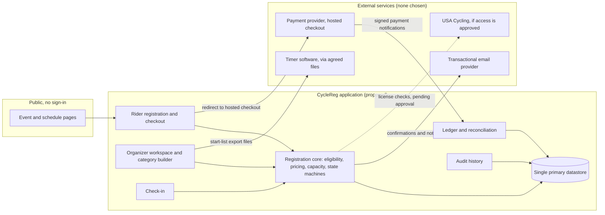

# Architecture (proposed)

**Status: Proposed.** Nothing in this document is built or accepted. It records the constraints any implementation must meet and the technical questions still open. Components become decided only through accepted [architecture decision records](decisions/README.md).

The short version: CycleReg needs one source of truth with strong consistency for capacity and money, a clear boundary between public schedule pages and private organizer and rider data, and replaceable connections to a payment provider, an email provider, timer files, and (if approved) USA Cycling. The technology stack is deliberately unchosen until Phase 0 answers the federation and payment questions, as [roadmap.md](../roadmap.md#next-actions) requires.

## Document maintenance rule (mandatory)

Every change must review both [product.md](../product.md) and [roadmap.md](../roadmap.md) for impact.

- Update `product.md` when requirements, scope, user flows, business rules, acceptance criteria, or product decisions change.
- Update `roadmap.md` when priorities, dependencies, milestones, blockers, or delivery status change.
- When a change affects neither document, state that explicitly in the change summary instead of making cosmetic edits.
- Keep `README.md` and affected guides consistent with the implementation.
- Mark roadmap work complete only after its acceptance criteria are verified.
- Distinguish planned, implemented, and verified behavior.
- Do not maintain a competing product roadmap elsewhere.

## Constraints from the product brief

These come from [product.md](../product.md) and apply whatever stack is chosen.

| Constraint | Why it matters | Source section |
|---|---|---|
| Atomic capacity across categories, start groups, pools, and bundles | Two buyers must never both get the last shared place | Capacity and entry integrity |
| Idempotent payment handling with authoritative confirmation | Retries and duplicate notifications must not create duplicate orders, charges, or entries | Money and reporting; acceptance criteria |
| Versioned configuration and price snapshots | Paid entries keep the rules and price they were sold under | Changes after registration opens |
| Independent entry, payment, and readiness states | Paying does not clear a rider to race | Data model |
| Server-enforced roles and least-privilege data access | Volunteers see only what their job needs; emergency contacts stay restricted | Quality requirements |
| Append-only audit history | Money, category, waiver, capacity, and permission changes stay traceable | Quality requirements |
| Hosted payment flow, no stored card data | Keeps card data out of the system entirely | Money and reporting |
| Mobile-first, accessible interface | Riders use phones; volunteers use tablets outdoors | Quality requirements |
| Connectivity required for live changes, with a printable fallback | Full offline sync is deferred and must not be advertised | Race-day operations |
| Backups with a demonstrated restore, and failure monitoring | Race-morning failures need a known recovery path | Quality requirements |
| Load and recovery checks at twice the expected pilot opening peak | Registration opening is the busiest moment | Quality requirements |

## Proposed logical components

This diagram shows logical parts, not services to deploy separately. Public schedule pages need no sign-in and show no private data. Rider checkout, the organizer workspace, and check-in all go through one registration core that owns eligibility, pricing, capacity, and state rules, so every checkout path enforces the same limits. One primary datastore keeps capacity and money consistent. The payment provider handles card entry on its own hosted page and reports results back through signed notifications that update the ledger. The dotted line to USA Cycling marks a connection that may never exist: [product.md](../product.md#integrations-and-dependencies) requires labeled simulated checks or a manual review process until USAC approves an integration. Timer exchange is by agreed files.

### Responsibilities

| Component | Owns | Does not own |
|---|---|---|
| Registration core | Eligibility evaluation, price calculation, reservations and capacity, entry and readiness transitions | Card data, email delivery |
| Organizer workspace | Category builder, impact previews, exception queue, corrections, exports | Rules enforcement (delegates to the core) |
| Rider registration | Profile, guardian entry, entry selection, waiver signing, receipts | Final price or capacity decisions |
| Check-in | Lookup, readiness display, bib assignment | Editing payments |
| Ledger | Order lines, fees, refunds, settlement references, reconciliation report | Deciding eligibility |
| Audit history | Who changed what, when, and why | Being editable |

## Data boundaries

- **Public:** published schedules, category descriptions, prices, start times, and, only if the organizer turns it on, a participant list without sensitive fields.
- **Rider-private:** profile, guardian relationships, orders, receipts, waiver status. Visible to the rider and to organizer roles that need it.
- **Restricted:** emergency contacts, license numbers, payment references, audit history. Limited to named roles.
- **Never stored:** card numbers and security codes.

Private pages must not be indexable by search engines. See [content-guide.md](content-guide.md#keep-private-data-out-of-public-pages).

## Open technical questions

Each of these needs an ADR before implementation depends on it. Options and tradeoffs are in the [decision backlog](decisions/README.md#decision-backlog).

1. Application stack (language, framework, front-end approach)
2. Primary datastore and the capacity-locking approach
3. Payment provider and merchant-of-record model
4. USA Cycling license and waiver path
5. Hosting, backups, and monitoring
6. Authentication for riders, guardians, and organizers
7. Transactional email provider
8. Timer export formats
9. Data retention and deletion periods

## How this document changes

When an ADR is accepted, update the matching section here, change its label from Proposed to the ADR's decision, and link the ADR. Keep this document describing the system as it is decided, and leave the reasoning in the ADRs.
