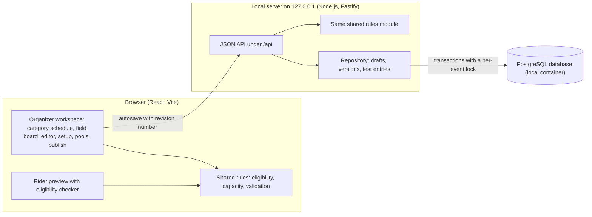

# Architecture

**Status: partly implemented.** The [local category builder](#what-exists-today-implemented) is built on the stack in [ADR 0001](decisions/0001-stack-for-category-builder-milestone.md). Everything under [Proposed logical components](#proposed-logical-components) beyond that build is still proposed. Components become decided only through accepted [architecture decision records](decisions/README.md).

The short version: CycleReg needs one source of truth with strong consistency for capacity and money, a clear boundary between public schedule pages and private organizer and rider data, and replaceable connections to Stripe (selected in [ADR 0002](decisions/0002-stripe-payments.md), integration Planned), an email provider, timer files, and (if approved) USA Cycling. The production stack stays open until Phase 0 answers the federation and payment questions, as [roadmap.md](../roadmap.md#next-actions) requires.

## What exists today (implemented)

The browser and the server import the same rules module (`src/shared`), so the preview, the issue list, and the server's save and publish checks always agree. The organizer edits a working copy; changes autosave about half a second after typing stops, carrying the revision number they started from. The server refuses a save from an out-of-date revision instead of overwriting newer work. Every write that can change capacity, holds, payments, or bibs runs in a PostgreSQL transaction that first takes that event's lock, which makes the capacity check and the insert one indivisible step, even across two server processes ([ADR 0004](decisions/0004-hosted-stack-and-database.md)). Publishing copies the draft into an immutable numbered version. Rider checkout reads only the latest published version. An order holds every place it needs in one transaction for 10 minutes; held, confirmed, and test entries all count toward limits, and expired holds stop counting without a background job. Simulated payment notifications carry an attempt ID and are processed once. Nothing is sent to USA Cycling. Payments use the simulated provider or Stripe test mode. Organizer invitation emails are recorded in the database and sent through Amazon SES only when `EMAIL_MODE=ses` is set for the test-only beta ([ADR 0006](decisions/0006-transactional-email-amazon-ses.md)). Every API route except the health check, the public event list, and rider event pages requires a Clerk session token (passwordless email sign-in, [ADR 0003](decisions/0003-sign-in-and-mfa.md) Phase 2); the server maps it to one account per person and checks that account's role in the event's organization before any organizer action (`src/server/auth.ts`, roles in `src/shared/roles.ts`). Adult orders remain under their placing account. Linked junior orders use current explicit guardian grants or the rider account recorded by a support-approved claim; original placing-account and waiver evidence remain provenance. Tests fake the session behind the same interface.

The protected reconciliation CSV (`reconciliation.ts`) projects linked payment attempts, sessions, provider notifications and refunds from one SQL statement under the event lock. It keeps unknown values and source identities, includes inactive orders and excludes unlinked notifications. It performs no provider calls or financial calculations; [Reporting](../product.md#reporting) owns interpretation and limits. `formatOrderNumber` in shared lookup keeps display references consistent with order views. The ledger-role-gated `ReconciliationDownload.tsx` section uses the existing authenticated download helper, preserving server filenames, with local progress/error feedback. Its in-memory read guard ignores repeat activation while ARIA-disabled/busy semantics retain keyboard focus. Search/filter state is not sent; no report data or pending write intent is stored in the browser.

Both protected CSV routes write restricted actor and file-scope metadata after preparation and before setting response attachment headers. A failure to record the metadata withholds the CSV. This adds evidence of generation without writing to transactional records or changing the export snapshot. See [Protected export audit](../DATA_MODEL.md#protected-export-audit).

Reviewed cancellation plan confirmation is a separate API foundation. It recomputes operational impact within an event transaction and hashes stable preview contents plus event-scoped payment-attempt/session/refund metadata. A matching fingerprint, reason and plan-only acknowledgement create an actor-attributed snapshot under a per-event unique request identity. Assessment times are excluded; effective expiry remains significant. Identical replay returns original evidence before fresh evaluation, and current event finance authority still applies. Normal confirmation routes only insert/read. The existing generated case-study reset deletes fixture plan evidence under sorted event locks while preserving unrelated records. A separate simulation-only executor and organizer controls now consume a plan with fresh checks and a second acknowledgement; provider/credit and message execution remain Planned. The Registrations confirmation screen was added November 18, 2026. A digest is no financial reservation or settlement proof, and future execution requires fresh state and reconciliation.

`cancellationFinancialPreflight.ts` adds a read-only financial preflight for an existing plan. Within the event transaction it evaluates fresh confirmation impact, then acquires affected `refunds:<order>` locks in sorted order and checks current accepted allocations, simulated settlement, provider evidence and refund history. Provider and refund-status updates may occur outside those locks; this response is never execution authority. Blocked assessments omit an eligible total, retain nominal cash lines only for inspection and leave the saved plan unchanged. The separate simulation-only executor consumes a new assessment inside its outer event transaction; the standalone assessment still authorizes nothing.

`cancellationExecution.ts` executes only with simulated payments. Its outer event transaction holds the sorted affected refund-request locks retained by preflight, calls existing capped refund requests (simulation only), marks selected entries cancelled, removes active waitlists and inserts one immutable plan-linked result. Migration 35 supplies durable closure; `cancellationClosure.ts` protects holds, checkout, transfers, waitlists and test entries, while late fulfillment goes to review. Frozen scope identities plus current placement prevent publication from reopening a cancelled scope. Draft save and publish compare proposed placement with the current published version and refuse moves into or out of closed scopes, including pre-existing drafts. Active-only check-in cards prevent cancelled entries from receiving readiness or manual/automatic bib allocation. Replays are checked before current-state evaluation. Overlaps require separate review of remaining uncancelled races. Mixed provider configurations are unsupported and no provider or message call is made.

The public event-detail read holds the event lock while loading published configuration, capacity and closure. `publicCancellationStatus` projects only committed scope selections and closed published category IDs using the same closure predicate as admission; no private execution evidence is returned. This adds no public route or write authority. `Register.tsx` displays scope/category cancellation before availability or offer text, prevents new closed choices and validates saved selections. Restored details/waiver drafts return to selection, while unresolved reservation recovery and order review preserve their server authority. Manual catalog refresh does not mutate the draft. The public schedule loads independently of private waitlist offer lookup. After sign-in, offer prefill uses a fresh event read after the private lookup. In-page retry repeats both reads and preserves unresolved reservation intent. The public catalog reads published versions and aggregated executed scope kinds in a single SQL statement, then shares the scope-state classifier with CSV downloads. `RegisterIndex` retains cancelled event links and distinguishes event-wide from scoped cancellation without implying availability. No per-event catalog read locks or extra application round trips are added. Protected check-in day lists read riders and print-safe cancellation context under one event lock. `Roster.tsx` prints each day’s notice without rewriting stored snapshots; different days remain independent requests. Protected CSV downloads use `cancellationExportState`/`cancellationExportFilename` under the event lock to label current closure and historical context without changing CSV schemas or saved snapshot rows. Entry/ledger and start-list readers keep their existing role checks.

`CancellationExecutionControls.tsx` is mounted independently of preview invalidation inside the server-account-scoped plan panel. Pending intent takes its original plan ID even if the parent data refreshes. A generation guard invalidates eligibility reads and acknowledgement on a new review or registration refresh; delayed reads cannot overwrite the newer plan. The protected execution-check reader and writer share one read-only preparation path; only explicit acknowledgement sends a POST. Migration 36 records terminal refusal evidence for plan and execution identities under the event lock before returning a no-action marker. Known write refusals require a successful savepoint rollback before the refusal commits. Success/refusal replay precedes reevaluation, so a delayed duplicate cannot act after rejection. Command methods raise the HTTP refusal only after their outer transaction commits; they are top-level endpoints. Unknown outcomes retain original intent, while verified evidence for the unique plan resolves recovery without a new write. Completed references reload by execution ID. Parent registrations/summary reload after saved evidence, preserving the execution outcome through failed refreshes. `CancellationScope.tsx` shares immutable published-scope naming between review and execution.

The confirmation screen consumes the existing confirmation-preview and plan-record APIs. A server account lookup scopes its recovery component and session-storage key; event and account changes remount that state. Pending intent survives preview invalidation, stores its original validated request and reviewed version, and is retried only explicitly. Only a server-marked no-record refusal clears it for a fresh acknowledged review; other unknown/conflicting results preserve it. The confirmation writer emits that marker only after the negative identity lookup, when a fingerprint changes or a fresh review fails with a definite 404/409/422 precondition. A successful outcome retains a record ID and is verified with an authorized GET on refresh. Published-version reads provide historical scope labels. Storage is best-effort; corrupt data blocks new confirmation and unavailable storage protects only the open page. No cancellation executor is invoked. A known completed reference that cannot be retrieved may be kept for lookup or cleared locally through an explicit separate review; this never discards an unresolved pending request or replaces server evidence.

The Registrations cancellation preview uses shared response contracts checked by the server return types. It fetches the public published configuration for scope choices and again before each preview; mismatched published versions fail with a retry path. Request generations discard older results after a selection or loaded registration/configuration change. It is a snapshot without execution actions.

The operational cancellation impact endpoint wraps the existing allocation reader in an outer event transaction, then reads live entries, active waitlists, capacity reservations and saved snapshot references. It returns a read-only audience manifest and hypothetical distinct-rider capacity differences. It neither recalls historical exports nor changes operational/financial state. Confirmation/execution and message content/delivery remain Planned. Event-wide snapshot references include removed races; linked live-order waitlist offers remain in the waitlist impact but are omitted from duplicate audience records. This does not deduplicate people across unrelated accounts/orders.

The paid cancellation allocation endpoint holds the event lock for a consistent current published placement/entry view, then batches accepted versions and refund history. It selects by current category/race/day but reads original quote-line allocation and accepted cancellation policy. No provider, credit or entry-state operation is performed; every result still requires financial reconciliation before an action. Full cancellation impact and execution remain Planned.

Shared junior profiles use one transaction-scoped family advisory lock across registration adoption, invitations, acceptance, viewer changes and profile corrections. Order writers acquire the event lock first, then the family lock before touching rows involved in a possible cross-event merge. Same-family soft merges preserve original access evidence; actor/time and invitation acceptance are stored separately from payment and waiver evidence. Explicit removal uses the same family lock and records reason/acknowledgement on a specific relationship, leaving one guardian after opposing requests. Guardian management screens call these existing authenticated APIs. Support claims use the same family lock to record approval and atomically revoke guardian grants, cancel pending invitations and retire viewing; linked orders recognize the claimed rider account without changing accepted order/payment/waiver evidence. Claim approval is disabled by default and requires configured age 18 plus a server account allowlist, separately from organizer roles. New junior checkout checks claimed-profile historical guardians/saved normalized block names under that family lock before order insertion, refusing a replacement registration pending support review; existing accepted orders are not retroactively invalidated. No claim screen, review queue, unblock endpoint or disputed restoration is built. See [the data model](../DATA_MODEL.md#junior_profiles).

| Concern | Where it lives |
|---|---|
| Document schema (Zod) | `src/shared/schema.ts` |
| Eligibility (AND within a path, OR between paths) | `src/shared/eligibility.ts` |
| Capacity limits, rider counted once | `src/shared/capacity.ts` |
| Pre-publication checks | `src/shared/validation.ts` |
| Templates, duplicate, reorder | `src/shared/factory.ts` |
| Demonstration data (labeled examples) | `src/shared/demo.ts` |
| HTTP routes | `src/server/app.ts` |
| Transactions and storage | `src/server/repo.ts`, `src/server/db.ts` |
| Pricing, bundles, and discount precedence | `src/shared/pricing.ts` |
| Checkout rules: conflicts, selection checks, readiness | `src/shared/checkout.ts` |
| Orders, holds, simulated payment, license review | `src/server/orders.ts` |
| Interface | `src/web/` (rider checkout in `Register.tsx`, exception queue in `Registrations.tsx`) |

### Post-close bib allocation

Opt-in automatic bib allocation runs inside each listening API process, once on startup and then once a minute. Durable jobs and assignment links are stored in PostgreSQL ([DATA_MODEL.md](../DATA_MODEL.md#automatic_bib_jobs)). Multiple API instances may poll the same job; the event lock and completion check permit one allocation. The job rechecks published closing windows, outstanding checkout holds, and the enabling organizer's current permission. All days and job completion commit together, with failed allocations rolled back for retry. Shutdown drains the running job before closing the database. No external scheduler or cloud resource is provisioned; a stopped API resumes pending work when restarted.

## Document maintenance rule (mandatory)

Every change must review both [product.md](../product.md) and [roadmap.md](../roadmap.md) for impact.

- Update `product.md` when requirements, scope, user flows, business rules, acceptance criteria, or product decisions change.
- Update `roadmap.md` when priorities, dependencies, milestones, blockers, or delivery status change.
- When a change affects neither document, state that explicitly in the change summary instead of making cosmetic edits.
- Keep `README.md` and affected guides consistent with the implementation.
- Mark roadmap work complete only after its acceptance criteria are verified.
- Distinguish planned, implemented, and verified behavior.
- Do not maintain a competing product roadmap elsewhere.

## Constraints from the product brief

These come from [product.md](../product.md) and apply whatever stack is chosen.

| Constraint | Why it matters | Source section |
|---|---|---|
| Atomic capacity across categories, start groups, pools, and bundles | Two buyers must never both get the last shared place | Capacity and entry integrity |
| Idempotent payment handling with authoritative confirmation | Retries and duplicate notifications must not create duplicate orders, charges, or entries | Money and reporting; acceptance criteria |
| Versioned configuration and price snapshots | Paid entries keep the rules and price they were sold under | Changes after registration opens |
| Independent entry, payment, and readiness states | Paying does not clear a rider to race | Data model |
| Server-enforced roles and least-privilege data access | Volunteers see only what their job needs; emergency contacts stay restricted | Quality requirements |
| Append-only audit history | Money, category, waiver, capacity, and permission changes stay traceable | Quality requirements |
| Hosted payment flow, no stored card data | Keeps card data out of the system entirely | Money and reporting |
| Mobile-first, accessible interface | Riders use phones; volunteers use tablets outdoors | Quality requirements |
| Connectivity required for live changes, with a printable fallback | Full offline sync is deferred and must not be advertised | Race-day operations |
| Backups with a demonstrated restore, and failure monitoring | Race-morning failures need a known recovery path | Quality requirements |
| Load and recovery checks at twice the expected pilot opening peak | Registration opening is the busiest moment | Quality requirements |

## Proposed logical components

This is the target shape for the hosted product. Only the registration core rules and the organizer workspace exist today, running locally on one computer. Accepted for the hosted product: sign-in through Clerk (email sign-in on the free plan; MFA on Clerk Pro with SMS off for organizer roles, required before the live pilot) ([ADR 0003](decisions/0003-sign-in-and-mfa.md)), and the existing TypeScript app on Render with Render Postgres ([ADR 0004](decisions/0004-hosted-stack-and-database.md)).

This diagram shows logical parts, not services to deploy separately. Public schedule pages need no sign-in and show no private data. Rider checkout, the organizer workspace, and check-in all go through one registration core that owns eligibility, pricing, capacity, and state rules, so every checkout path enforces the same limits. One primary datastore keeps capacity and money consistent. The payment provider handles card entry on its own hosted page and reports results back through signed notifications that update the ledger. The dotted line to USA Cycling marks a connection that may never exist: [product.md](../product.md#integrations-and-dependencies) requires labeled simulated checks or a manual review process until USAC approves an integration. Timer exchange is by agreed files.

### Responsibilities

| Component | Owns | Does not own |
|---|---|---|
| Registration core | Eligibility evaluation, price calculation, reservations and capacity, entry and readiness transitions | Card data, email delivery |
| Organizer workspace | Category builder, impact previews, exception queue, corrections, exports | Rules enforcement (delegates to the core) |
| Rider registration | Profile, guardian entry, entry selection, waiver signing, receipts | Final price or capacity decisions |
| Check-in | Lookup, readiness display, bib assignment | Editing payments |
| Ledger | Order lines, fees, refunds, settlement references, reconciliation report | Deciding eligibility |
| Audit history | Who changed what, when, and why | Being editable |

## Data boundaries

- **Public:** published schedules, category descriptions, prices, start times, and, only if the organizer turns it on, a participant list without sensitive fields.
- **Rider-private:** profile, guardian relationships, orders, receipts, waiver status. Visible to the rider and to organizer roles that need it.
- **Restricted:** emergency contacts, license numbers, payment references, audit history. Limited to named roles.
- **Never stored:** card numbers and security codes.

Private pages must not be indexable by search engines. See [content-guide.md](content-guide.md#keep-private-data-out-of-public-pages).

## Open technical questions

Each of these needs an ADR before implementation depends on it. Options and tradeoffs are in the [decision backlog](decisions/README.md#decision-backlog).

1. Application stack (language, framework, front-end approach): decided in [ADR 0004](decisions/0004-hosted-stack-and-database.md)
2. Primary datastore and the capacity-locking approach: decided in [ADR 0004](decisions/0004-hosted-stack-and-database.md) (PostgreSQL)
3. Merchant-of-record and Stripe charge/transfer/settlement operating model (provider selected in ADR 0002)
4. USA Cycling license and waiver path
5. Hosting, backups, and monitoring: decided in [ADR 0004](decisions/0004-hosted-stack-and-database.md) (Render)
6. Authentication for riders, guardians, and organizers: decided in [ADR 0003](decisions/0003-sign-in-and-mfa.md) (Clerk; email sign-in for everyone, MFA for organizer roles before the live pilot, SMS off)
7. Transactional email provider: decided in [ADR 0006](decisions/0006-transactional-email-amazon-ses.md) (Amazon SES; organizer invitation emails implemented, test-only)
8. Timer export formats
9. Data retention and deletion periods

## How this document changes

When an ADR is accepted, update the matching section here, change its label from Proposed to the ADR's decision, and link the ADR. Keep this document describing the system as it is decided, and leave the reasoning in the ADRs.

## Planned multi-organization purchases

The [product requirements](../product.md#cross-organization-bundles-and-season-passes) distinguish same-event packages from cross-event, cross-organization bundles/season passes. The current event-scoped configuration and orders implement only same-event purchases. Planned passes require approved membership across organizations, accepted per-event configuration references, a shared purchase record with component entries and financial allocations, all-component capacity reservations, and role-isolated views. Design and migration details remain open; no cross-organization tables, approvals, settlements, or Stripe accounts exist today. Stripe provider selection does not settle the multi-party operating model.
