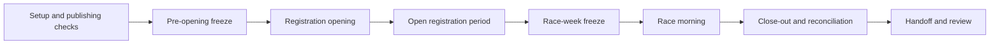

# Operations (proposed)

**Status: Proposed.** Nothing here is in use. The application runs locally; there is no hosted production service, demonstrated monitoring, or staffed support rota. This document sets out how CycleReg is meant to be operated once it exists, so that operating needs shape the build instead of being added after it. The requirements it draws on are in [product.md](../product.md#quality-requirements); the phases that deliver them are in [roadmap.md](../roadmap.md#phase-3--make-race-day-operable).

The short version: every event has a named support owner and escalation route, the riskiest moments (registration opening and race morning) get a change freeze and a rehearsed fallback, money and capacity problems are treated as critical, and a successor organizer must be able to run all of it without the developer.

## Document maintenance rule (mandatory)

Every change must review both [product.md](../product.md) and [roadmap.md](../roadmap.md) for impact.

- Update `product.md` when requirements, scope, user flows, business rules, acceptance criteria, or product decisions change.
- Update `roadmap.md` when priorities, dependencies, milestones, blockers, or delivery status change.
- When a change affects neither document, state that explicitly in the change summary instead of making cosmetic edits.
- Keep `README.md` and affected guides consistent with the implementation.
- Mark roadmap work complete only after its acceptance criteria are verified.
- Distinguish planned, implemented, and verified behavior.
- Do not maintain a competing product roadmap elsewhere.

This document describes the operating model. Step-by-step procedures belong in `docs/runbooks/`; the phone handoff and check-in volunteer guides exist for local rehearsals, while accepted recovery procedures remain Proposed. See [documentation-guide.md](documentation-guide.md#where-things-live).

The [check-in volunteer guide](runbooks/race-day-check-in.md) covers desk preparation, role boundaries, blocked riders, uncertain outcomes and shift handoff. It is source-checked documentation, not evidence of staff independence or an approved offline process.

The first phone-first desk increment has a [walk-up registration runbook](runbooks/walkup-registration.md). It reuses participant checkout and existing check-in; it does not complete the operational rehearsals below.

## Who does what

These map to the roles in [roadmap.md](../roadmap.md#responsibilities). They are roles to assign, not people already committed.

| Role | Operating duties |
|---|---|
| Support owner | First contact for organizer and volunteer problems on opening day and race day; runs incidents; sends status updates |
| Technical lead | Fixes system faults, restores from backup, rotates secrets, approves changes during a freeze |
| Registration lead | Works the exception queue; decides rider-level corrections; trains check-in volunteers |
| Treasurer | Refund approvals, payout checks, reconciliation against provider statements |
| Timer / officials liaison, where applicable | Confirms start-list snapshots and exports; reports race-day field changes back |
| Event owner (organizer role) | Publishes the event's support contact; transfers ownership to a successor |

Each event must publish, before registration opens:

- the support owner's name and how to reach them on opening day and race morning;
- a backup contact if the support owner cannot respond; and
- where volunteers find the printable fallback and the event runbook.

A volunteer should never have to guess who handles a race-morning failure. The [support coverage rehearsal](testing/test-plan.md#support-coverage-rehearsal) uses fictional assignments by owner decision on November 19, 2026. Named coverage and funding remain open.

## Operating calendar for an event

An event moves through these stages in order. The two freezes protect the busiest moments: registration opening, when demand peaks, and race morning, when there is no time to recover from a bad change. Close-out reconciles money and entries before the event is handed to its next owner.

| Stage | What happens | Exit check |
|---|---|---|
| Setup and publishing checks | Organizer configures categories, limits, prices, bib ranges, and questions; publishing checks run | Preview of every day reviewed by the registration lead |
| Pre-opening rehearsal freeze (starts 48 hours before registration opens) | No code or configuration changes except fixes approved by the technical lead | Support owner confirmed; monitoring and alerts tested |
| Registration opening | Support owner watches payments, capacity, and email for the first hours | No stuck reservations, failed payment notifications, or bounced confirmations left unexplained |
| Open registration period | Exception queue worked at least every few days; corrections logged with a reason | Queue has no item older than the agreed limit |
| Race-week rehearsal freeze (starts 72 hours before the first start) | Changes limited to rider-level corrections and approved fixes | Start-list snapshot sent to the timer; fallback roster printed |
| Race morning | Check-in, bib assignment, field changes, timer updates | Every change after the snapshot appears in the change report |
| Close-out | Refunds settled, ledger reconciled with provider statements, exports archived | Treasurer signs off reconciliation |
| Handoff and review | Lessons recorded; template cloned for next year; ownership transferred if needed | A successor can open the event and its runbook without the original owner's credentials |

The project owner approved both freeze start times for Phase 3 rehearsal on November 19, 2026. Before scheduling the exercise, the pilot organizer and registration lead confirm each end time and record both windows and the event time zone in the event runbook. Include the registration-opening exercise in the first window and the race-morning desk exercise in the second. Live freeze acceptance remains with the pilot organizer.

## Incident severity

An incident is anything that stops riders registering, stops volunteers checking riders in, or makes money, capacity, or entry records wrong.

| Severity | Examples | Initial response |
|---|---|---|
| Critical | Oversold place, duplicate charge, lost confirmed entry, unexplained ledger difference, private data exposed, checkout down during registration opening, check-in unusable on race morning | For the approved rehearsal windows, contact the support owner and technical lead immediately on detection. Pause affected registration if records are being corrupted. Out-of-window targets remain open. |
| High | Payment notifications delayed, confirmation emails not sending, required start-list handoff fails, a role sees data it should not | Within one hour of detection or report during the approved rehearsal windows. Same-day response outside those windows remains proposed. |
| Normal | A single rider's record wrong, a confusing message, a slow report | Next working session (proposed) |

The project owner approved the critical and high initial-response targets for the two rehearsal windows on November 19, 2026. Initial response means acknowledging the incident, identifying the accountable role and recording the first action or escalation. It does not end the safe-reopening clock.

The critical examples match the integrity failures that [product.md](../product.md#success-measures) says must be zero, and any unresolved critical defect blocks the pilot ([roadmap.md](../roadmap.md#critical-risks-and-decision-points)).

## Handling an incident

1. **Stop the damage.** If money, capacity, or entries are being recorded wrongly, pause registration for the affected event. Pausing is preferred over letting bad records pile up.
2. **Tell people.** The support owner posts a short status to organizers and, if riders are affected, a rider-facing notice that says what is wrong and what to do. Do not promise a time you cannot meet.
3. **Fix or fall back.** If check-in cannot be restored quickly, use the printable roster and exception checklist as references and hold affected bib handovers. The [proposed outage rehearsal](runbooks/race-day-check-in.md#reconcile-a-reference-only-outage) covers lead escalation and recovery with fictional data. Connectivity is required for live changes; offline sync does not exist and must not be promised.
4. **Reconcile.** Before reopening, compare entries, capacity counts, and the ledger against the payment provider's records. Correct with an audit reason; never edit history.
5. **Record it.** Write a short incident note: what happened, who was affected, what was done, and what will prevent it. Link it from the event's review.

## Rehearsal alert routing

The project owner approved this routing for the pilot rehearsal on November 19, 2026. Use fictional role assignments. During registration opening and race morning, send the initial alert to the support primary, who is the initial support owner. For a critical incident, contact the technical lead immediately at detection as well. Do not wait for the primary to acknowledge.

Before the exercise, the facilitator records the delay between each initial alert and its deputy escalation cue. The facilitator tracks acknowledgements in the shared incident timeline. If the primary has not acknowledged at the cue, contact the deputy. The deputy records acknowledgement, and the facilitator records the acceptance time as the handoff time and notifies the primary. The facilitator, primary and deputy can see the acknowledgement and the current owner. An acknowledgement before the cue cancels the deputy escalation. If the primary acknowledges after the cue, continue the escalation and record a single transfer of ownership when the deputy accepts.

This decision covers rehearsal routing. Named coverage, live routing, alert tooling and out-of-window timings remain open under [Open questions](#open-questions). Use the [support coverage rehearsal](testing/test-plan.md#support-coverage-rehearsal) to exercise on-time, missing and late primary acknowledgements.

## Monitoring and alerts

Proposed live signals and recipients, from [product.md](../product.md#quality-requirements). For the rehearsal, use the approved routing above. Tools are not chosen; see the hosting, backups, and monitoring entry in the [decision backlog](decisions/README.md#decision-backlog).

| Signal | Why | Alert goes to |
|---|---|---|
| Failed or delayed payment notifications | Paid riders without entries, or entries without payment | Technical lead, support owner |
| Capacity reservations older than their expiry | Places held that no one can buy | Technical lead |
| Checkout error rate during opening | Riders cannot register | Support owner |
| Email bounces and suppressions | Riders miss confirmations or race notices | Support owner |
| Sign-in and second-factor failure spikes | Riders locked out, or an attack | Technical lead |
| Backup job failures | Recovery would not be possible | Technical lead |
| `GET /api/health` failing (HTTP 503 means the app is up but cannot reach the database) | Nobody can register or check in | Technical lead |

Alerts must not include card data, emergency contacts, or other restricted fields.

Implemented in the local build (November 15, 2026): `GET /api/health` runs a database query and answers 503 when it fails, so a platform health check (Render's health-check path, per [ADR 0004](decisions/0004-hosted-stack-and-database.md)) can take an instance out of service. A lost database connection is logged and does not end the process. Work that needed it fails; a migration that had already finished and lost it only while releasing its lock still counts as done. On `SIGTERM` the server stops taking new requests, finishes the ones in progress, and closes its database connections. The [local database health check](testing/test-plan.md#local-database-health-check) verifies the outage and return to HTTP 200 without restarting the application. No platform is configured yet. The planned Render setup is in [docs/runbooks/deploy-render.md](runbooks/deploy-render.md).

### Proposed pilot signal checks

These checks say how a signal is noticed. Who is contacted, when the deputy is called and who sees the acknowledgement follow the approved [rehearsal alert routing](#rehearsal-alert-routing). Evaluate one delivered health alert and two manual checks. Missing or delayed payment notifications have their own [proposed check](#proposed-pilot-payment-check). Platform access, staffing and timing need approval before hosted rehearsal. Assign accountable operators while preserving existing application and provider permissions.

| Signal | Proposed observation and timing | Accountable role |
|---|---|---|
| Service unhealthy | **Delivered alert candidate.** Evaluate Render failure notifications against the existing health-check path. Choose the channel and prove delivery to the support primary, plus the technical lead at detection for a critical incident. The endpoint checks database connectivity. Verify checkout, desk and dependencies separately before declaring them available. [Render health checks](https://render.com/docs/health-checks), [Render notifications](https://render.com/docs/notifications) | Support primary receives and owns until a deputy accepts; technical lead also receives a critical incident |
| Organizer invitation delivery failure | **Manual.** On a controlled test send or report, an owner checks Team for the application send status. An authorized provider operator checks the test recipient and timestamp in Resend. A successful API send only means acceptance for delivery. A local rejection, such as an unlisted recipient, may have no provider record. The provider check needs an isolated non-production test setup: the hosted services run in production mode, which refuses Resend, so there it is Blocked. Clerk sign-in email follows its own provider rehearsal. [Resend email event types](https://resend.com/docs/webhooks/event-types#email-events) | Organization owner and approved Resend operator; support owner coordinates |
| Recovery coverage missing | **Manual.** Before each critical window and during restore, check the available point and retention window against the approved recovery plan. Escalate a missing or unusable point. Wait only when a suitable point is due, and count the wait. If none will become available, record a recovery hold and keep the service closed. [Render Postgres recovery and backups](https://render.com/docs/postgresql-backups) | Technical lead with approved database access |

Use fictional records. Limit messages to environment, signal, observation time and accountable role. Keep rider details, payment references and provider payloads in their approved restricted views. For a delivered alert, record receipt and acknowledgement in the shared incident timeline and, only if the primary has not acknowledged by the cue, exercise the deputy route. For a manual check, record who observed it, when, and how they escalated. Native notification routing, automated payment and invitation alerts, rider email, backup job alerts, checkout error rate, expired holds and sign-in spikes remain open.

### Proposed pilot payment check

**Proposed, manual.** Finds a payment the application did not apply because a notification was late, missing or not matched. One person does it only if they hold both approved Stripe access and an owner or finance role. Otherwise the technical lead and an owner or finance user do it together, each reading only what their own access allows, and the export is not handed over. The check leaves payments and registrations unchanged; the export download is recorded in the audit. Run it on a report, at shift start and at an interval the pilot organizer confirms.

1. **Start from payments, not events.** In the Stripe environment the application uses, list every Checkout Session created since registration opened. The application writes the order ID on each session (`client_reference_id` and `metadata.order_id`) and on its payment (`metadata.order_id`). Count a session and its payment as one, and also list a payment that carries an order ID but has no listed session. Records without an order ID are not the application's. Repeat the whole list at each check, so a payment that settles later, or during a check, is seen by the next one. This does not depend on Stripe's event history, which [goes back 30 days](https://docs.stripe.com/api/events/list). For a report, look up that payment however old it is.
2. **Keep to one event.** Check a record when its session reference, payment reference or order ID is in this event's export. A session or payment found here whose order ID differs from its row's order is escalated before anything is left to another event. Only a record with none of the three here is left to the other events' checks, and one in no event's export is escalated.
3. **Record the coverage.** Note when the list was taken, then download the export. Recheck a difference once before escalating, because a notification can arrive between the two. If the list or export is unavailable or incomplete, record that period as unverified and escalate.
4. **Classify each payment from Stripe.** Paid means the payment succeeded, including one refunded later. Failed means the session completed, the payment did not succeed and it shows a payment error or was canceled. Not settled means it is still processing or its session is still open. Expired means the session expired with nothing paid. Escalate anything else.
5. **Match it.** Find the session and payment reference in the export's `provider_event` rows and read `outcome` and `result_status`. An earlier completion event does not stand in for a later success or failure. A matching order status alone is not a match. Use the first line below that applies.

| What the check finds | Action |
|---|---|
| Any row for it recorded as `unknown_session` | Escalate, whatever its outcome. A known session with a different order reference keeps its row in the export; an unknown session has none |
| Paid, with no `paid` row | Escalate, including when no event, delivery or row exists. Inspect the delivery before requesting a resend |
| Paid, recorded as `duplicate_charge` | Follow the duplicate rule below |
| Paid, recorded as `needs_attention` | Confirm the exception queue has it |
| Paid, recorded as `confirmed` | None |
| Failed, with no `failed` row | Escalate |
| Failed, with a `failed` row | None. The order can correctly stay confirmed by another payment |
| Not settled | Leave it for the next check |
| Expired | None, with or without a `session_expired` row: nothing was paid |
| Anything else | Escalate |

**Duplicate rule.** Use only Stripe's refunds of that payment and the `refund` rows with the same `payment_reference`. Match each Stripe refund to a row by the provider refund ID (`provider_reference`), and read Stripe's `requires_action` as `pending`, as the application does. A local `requested` row with no provider ID has not been confirmed by Stripe: escalate it to finance to reconcile, and do not create a replacement. Any other refund on one side only, or with a different amount or status, is also escalated. If any refund was escalated, stop there. Otherwise `succeeded` counts as returned, `pending` as on the way, and `failed` and `canceled` as nothing. Returned covering the charge needs no action. If it covers the charge only with what is on the way, follow it until it settles. Otherwise the shortfall goes to finance.

Use fictional records in rehearsal, and keep payment references in the approved restricted views. Escalation follows the approved [rehearsal alert routing](#rehearsal-alert-routing).

### Checking a pending reservation

This lookup is available in the local build. An owner, registration manager or finance user opens the correct event’s **Registrations**, expands **Check a pending reservation**, and enters the reference from the rider’s pending checkout. The result shows the saved order number, status and, for an active hold, its expiry. The reference matches exactly as entered, including any spaces. Checkout generates it as a single-line UUID. A result switches the list to **All** and refreshes it, so staff can use the order number in **Find a registration** to see the order under normal permissions. If the list shows a loading error, select **Check reservation** again.

If the result says no order is visible yet, have the rider keep that tab and retry the same reservation. The original request may still be processing.

Approved routing (November 19, 2026, project owner). The primary contact is the event's registration lead. The backup is the event owner or a designated deputy. After two failed retries of the same reservation, the rider contacts the registration lead, and goes to the backup if the lead is unavailable. If several riders are affected or a payment may have gone through, escalate immediately to the technical lead, and involve the treasurer for payment questions. The owner still needs to name those people before the rehearsal.

A registration manager or owner can choose **Release unpaid hold** after finding the exact saved hold. Confirm that the rider asked for release and enter a reason without names or contact details. The app rechecks the hold and payment evidence and records the staff account, time and reason. Ask the rider to retry once from the original checkout to see that the hold was released. If the payment is uncertain or the hold is too old to verify its payment history, route it to the treasurer. [Verification and permission rules](../product.md#uncertain-reservation-support-decision).

## Backups and recovery

The [local fictional-data restore procedure](runbooks/local-backup-restore.md) exercises a separate logical archive/restore, record comparison and application recovery checks without touching the working database. It prepares the team for the hosted rehearsal. Hosted scheduled and off-site recovery and staff acceptance remain open.

- Back up the primary datastore on the schedule and point-in-time recovery policy in the [hosting ADR](decisions/0004-hosted-stack-and-database.md), and keep copies somewhere a single failure cannot remove.
- A backup counts only after a restore has been demonstrated. Phase 3 requires that demonstration during the mock-weekend rehearsal ([roadmap.md](../roadmap.md#phase-3--make-race-day-operable)).
- Measure the approved targets in the [hosted recovery rehearsal](testing/test-plan.md#measure-hosted-recovery-before-the-pilot).
- After any restore, reconcile entries and the ledger with the payment provider before reopening.

The project owner approved these pilot rehearsal targets on November 19, 2026.

| Window | Maximum database recovery gap | Maximum time to safe reopening |
|---|---:|---:|
| Registration opening | 5 minutes | 60 minutes |
| Race morning | 5 minutes | 30 minutes |

The database recovery gap is the time between the latest recovered committed change and the disruption. The reopening clock runs from disruption through detection, restore, application recovery, reconciliation and the operator’s decision. Account for every confirmed payment, entry and affected bib before reopening. Keep the affected desk or registration paused while a discrepancy remains. If the time target is exceeded, record the overrun and escalate to the project owner. Reopen only after reconciliation and authorization to resume. Hosted measurement and operator acceptance are open.

## Changes and releases

- Every change follows [CONTRIBUTING.md](../CONTRIBUTING.md) and is reviewed before it reaches the running system.
- No releases during a freeze unless the technical lead approves a fix and the support owner knows it is going out.
- Configuration changes to a published event go through the impact preview; paid entries keep the price and rules they were sold under ([product.md](../product.md#changes-after-registration-opens)).
- Each release has a known way back: a previous version to return to, and a note of any data change that cannot be reversed.

## Access and secrets

- Every person uses their own account (organizers with MFA enforced at the final pre-launch security gate, before the live pilot), including on shared check-in tablets ([product.md](../product.md#sign-in-and-account-security)).
- Give each role the least access its job needs. Remove access when a volunteer's event ends.
- Secrets live in the hosting platform's secret store, never in the repository or in chat. Rotate them when someone with access leaves, and after any suspected exposure.
- Access to restricted data (emergency contacts, license numbers, payment references, audit history) is logged. Looking up one emergency contact records the signed-in account, event, order, and time, and does not store the contact.

## Rider data requests

The emergency-contact lookup record has an approved retention of 365 days, not yet enforced. Other retention periods and every deletion procedure are not set; they are in the [decision backlog](decisions/README.md#decision-backlog) and must be decided before the pilot. Until then:

- route requests to see, correct, or delete rider data to the event owner and the support owner;
- keep waiver and financial records that the federation or tax rules may require, even when other data is deleted; and
- record each request and its outcome in the audit history.

## Handoff to a successor

The [organizer handoff guide](runbooks/organizer-handoff.md) documents the existing organization-wide role transfer, retained access, successor checks and uncertain-result recovery. Its local separate-account rehearsal is technical evidence only; actual successor/volunteer acceptance and external responsibilities remain open.

The handoff acceptance criterion in [product.md](../product.md#core-flows-and-acceptance-criteria) is the test: a second authorized organizer can operate the event and its runbook without the original owner's credentials. To support it:

- keep each event's runbook, support contacts, and fallback documents inside the organizer workspace, not in one person's email;
- use event templates so next year's setup starts from this year's verified configuration; and
- transfer ownership through the product, never by sharing a login.

The [readiness checklist](research/prelaunch-readiness.md#race-day-readiness-checklist), [failure recovery matrix](research/prelaunch-readiness.md#payment-and-failure-recovery-matrix) and [Proposed measurement protocol](research/prelaunch-readiness.md#proposed-launch-measurement-specification) identify evidence for the existing operating requirements. They do not establish staff independence or approve telemetry collection.

## Open questions

1. Who funds and staffs support after launch? ([product.md](../product.md#open-decisions), question 3)
2. Freeze starts and critical/high initial-response targets are approved for rehearsal. Event-specific window end times, live operating acceptance and actual coverage remain open under [Operating calendar](#operating-calendar-for-an-event) and [Incident severity](#incident-severity).
3. Recovery targets approved November 19, 2026. Hosted proof and operator acceptance remain open under [Backups and recovery](#backups-and-recovery).
4. Which monitoring and alerting tools fit a small volunteer team? (hosting ADR)
5. What retention periods apply to waivers, financial records, and everything else except the emergency-contact lookup record (365 days, decided November 22, 2026)?

### November 16, 2026 research follow-up

Unresolved operating decisions and validation steps are listed below. The named roles still need assigned operators. Research and fictional scenario design can proceed under the provisional assumptions.

| Existing question | Owner / why it matters | Provisional assumption, blocked work and revisit |
|---|---|---|
| 1, support coverage | Project owner; named primary/deputy needed for independent operation | Assume no committed coverage. Live event support remains blocked; revisit before hosted pilot rehearsal. Includes responsibility for paid-but-not-ready follow-up and measurement review. |
| 2, freeze/response targets | Product owner with registration lead; race-morning disruption needs an agreed response | Rehearsal freeze starts and critical/high response targets approved November 19, 2026. Rehearse both windows. Confirm event-specific window end times before rehearsal. Live acceptance, named staffing and out-of-window response targets remain open. |
| 3, recovery measurement | Technical lead and treasurer, unassigned; restore must preserve money, capacity and entries | Targets approved November 19, 2026. Hosted measurement and recovery sign-off remain open. Run the hosted rehearsal once its environment and operators are approved. |
| 4, monitoring/tools | Technical/support lead, unassigned; failures need an accountable receiver | [Rehearsal routing](#rehearsal-alert-routing) is approved. Live recipients, monitoring service, alert thresholds and after-hours coverage remain open. Synthetic fault cases can proceed. Revisit live routing and tooling before hosted operational sign-off. |
| 5, retention | Project owner/privacy responsibility unassigned; waivers, financial records, paper rosters and opaque telemetry keys remain personal data | Only the emergency-contact lookup record has an approved period (365 days, November 22, 2026; enforcement Planned). No other retention period or analytics collection approved. Synthetic measurements proceed; real-data collection blocked until access/retention approval before pilot. |

Related decisions remain in [product.md decisions 4–6 and 8–10](../product.md#open-decisions), [ADR 0005](decisions/0005-merchant-and-settlement-model.md), [federation questions](usac-questions.md) and [timer review](timer-export-review.md). The new research does not resolve merchant liability, event-year waiver/licensing approval, timer acknowledgement where applicable or safe device/accessibility arrangements. Revisit those existing records before the corresponding live-money, sanctioned-event or physical rehearsal gate.
