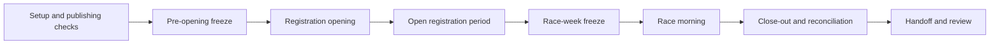

# Operations (proposed)

**Status: Proposed.** Nothing here is in use. There is no running system, no hosting, no monitoring, and no support rota. This document sets out how CycleReg is meant to be operated once it exists, so that operating needs shape the build instead of being added after it. The requirements it draws on are in [product.md](../product.md#quality-requirements); the phases that deliver them are in [roadmap.md](../roadmap.md#phase-3--make-race-day-operable).

The short version: every event has a named support owner and escalation route, the riskiest moments (registration opening and race morning) get a change freeze and a rehearsed fallback, money and capacity problems are treated as critical, and a successor organizer must be able to run all of it without the developer.

## Document maintenance rule (mandatory)

Every change must review both [product.md](../product.md) and [roadmap.md](../roadmap.md) for impact.

- Update `product.md` when requirements, scope, user flows, business rules, acceptance criteria, or product decisions change.
- Update `roadmap.md` when priorities, dependencies, milestones, blockers, or delivery status change.
- When a change affects neither document, state that explicitly in the change summary instead of making cosmetic edits.
- Keep `README.md` and affected guides consistent with the implementation.
- Mark roadmap work complete only after its acceptance criteria are verified.
- Distinguish planned, implemented, and verified behavior.
- Do not maintain a competing product roadmap elsewhere.

This document describes the operating model. Step-by-step runbooks for specific tasks belong in `docs/runbooks/` (planned), created once there is something to run. See [documentation-guide.md](documentation-guide.md#where-things-live).

## Who does what

These map to the roles in [roadmap.md](../roadmap.md#responsibilities). They are roles to assign, not people already committed.

| Role | Operating duties |
|---|---|
| Support owner | First contact for organizer and volunteer problems on opening day and race day; runs incidents; sends status updates |
| Technical lead | Fixes system faults, restores from backup, rotates secrets, approves changes during a freeze |
| Registration lead | Works the exception queue; decides rider-level corrections; trains check-in volunteers |
| Treasurer | Refund approvals, payout checks, reconciliation against provider statements |
| Timer / officials liaison | Confirms start-list snapshots and exports; reports race-day field changes back |
| Event owner (organizer role) | Publishes the event's support contact; transfers ownership to a successor |

Each event must publish, before registration opens:

- the support owner's name and how to reach them on opening day and race morning;
- a backup contact if the support owner cannot respond; and
- where volunteers find the printable fallback and the event runbook.

A volunteer should never have to guess who handles a race-morning failure.

## Operating calendar for an event

An event moves through these stages in order. The two freezes protect the busiest moments: registration opening, when demand peaks, and race morning, when there is no time to recover from a bad change. Close-out reconciles money and entries before the event is handed to its next owner.

| Stage | What happens | Exit check |
|---|---|---|
| Setup and publishing checks | Organizer configures categories, limits, prices, bib ranges, and questions; publishing checks run | Preview of every day reviewed by the registration lead |
| Pre-opening freeze (proposed: 48 hours) | No code or configuration changes except fixes approved by the technical lead | Support owner confirmed; monitoring and alerts tested |
| Registration opening | Support owner watches payments, capacity, and email for the first hours | No stuck reservations, failed payment notifications, or bounced confirmations left unexplained |
| Open registration period | Exception queue worked at least every few days; corrections logged with a reason | Queue has no item older than the agreed limit |
| Race-week freeze (proposed: from 72 hours before the first start) | Changes limited to rider-level corrections and approved fixes | Start-list snapshot sent to the timer; fallback roster printed |
| Race morning | Check-in, bib assignment, field changes, timer updates | Every change after the snapshot appears in the change report |
| Close-out | Refunds settled, ledger reconciled with provider statements, exports archived | Treasurer signs off reconciliation |
| Handoff and review | Lessons recorded; template cloned for next year; ownership transferred if needed | A successor can open the event and its runbook without the original owner's credentials |

Freeze lengths are proposals for the pilot organizer to confirm.

## Incident severity

An incident is anything that stops riders registering, stops volunteers checking riders in, or makes money, capacity, or entry records wrong.

| Severity | Examples | Response target (proposed) |
|---|---|---|
| Critical | Oversold place, duplicate charge, lost confirmed entry, unexplained ledger difference, private data exposed, checkout down during registration opening, check-in unusable on race morning | Support owner engaged immediately; technical lead paged; registration paused if records are being corrupted |
| High | Payment notifications delayed, confirmation emails not sending, timer export rejected, a role sees data it should not | Same day, or within the hour on opening day or race morning |
| Normal | A single rider's record wrong, a confusing message, a slow report | Next working session |

The critical examples match the integrity failures that [product.md](../product.md#success-measures) says must be zero, and any unresolved critical defect blocks the pilot ([roadmap.md](../roadmap.md#critical-risks-and-decision-points)).

## Handling an incident

1. **Stop the damage.** If money, capacity, or entries are being recorded wrongly, pause registration for the affected event. Pausing is preferred over letting bad records pile up.
2. **Tell people.** The support owner posts a short status to organizers and, if riders are affected, a rider-facing notice that says what is wrong and what to do. Do not promise a time you cannot meet.
3. **Fix or fall back.** Race morning uses the printable fallback roster and exception checklist if check-in cannot be restored quickly. Connectivity is required for live changes; offline sync does not exist and must not be promised.
4. **Reconcile.** Before reopening, compare entries, capacity counts, and the ledger against the payment provider's records. Correct with an audit reason; never edit history.
5. **Record it.** Write a short incident note: what happened, who was affected, what was done, and what will prevent it. Link it from the event's review.

## Monitoring and alerts

Proposed signals, from [product.md](../product.md#quality-requirements). Tools are not chosen; see the hosting, backups, and monitoring entry in the [decision backlog](decisions/README.md#decision-backlog).

| Signal | Why | Alert goes to |
|---|---|---|
| Failed or delayed payment notifications | Paid riders without entries, or entries without payment | Technical lead, support owner |
| Capacity reservations older than their expiry | Places held that no one can buy | Technical lead |
| Checkout error rate during opening | Riders cannot register | Support owner |
| Email bounces and suppressions | Riders miss confirmations or race notices | Support owner |
| Sign-in and second-factor failure spikes | Riders locked out, or an attack | Technical lead |
| Backup job failures | Recovery would not be possible | Technical lead |
| `GET /api/health` failing (HTTP 503 means the app is up but cannot reach the database) | Nobody can register or check in | Technical lead |

Alerts must not include card data, emergency contacts, or other restricted fields.

Implemented in the local build (November 15, 2026): `GET /api/health` runs a database query and answers 503 when it fails, so a platform health check (Render's health-check path, per [ADR 0004](decisions/0004-hosted-stack-and-database.md)) can take an instance out of service. On `SIGTERM` the server stops taking new requests, finishes the ones in progress, and closes its database connections. No platform is configured yet.

## Backups and recovery

- Back up the primary datastore on a schedule set by the hosting ADR, and keep copies somewhere a single failure cannot remove.
- A backup counts only after a restore has been demonstrated. Phase 3 requires that demonstration during the mock-weekend rehearsal ([roadmap.md](../roadmap.md#phase-3--make-race-day-operable)).
- Record a target for how much data may be lost and how long a restore may take, agreed with the pilot organizer before the pilot.
- After any restore, reconcile entries and the ledger with the payment provider before reopening.

## Changes and releases

- Every change follows [CONTRIBUTING.md](../CONTRIBUTING.md) and is reviewed before it reaches the running system.
- No releases during a freeze unless the technical lead approves a fix and the support owner knows it is going out.
- Configuration changes to a published event go through the impact preview; paid entries keep the price and rules they were sold under ([product.md](../product.md#changes-after-registration-opens)).
- Each release has a known way back: a previous version to return to, and a note of any data change that cannot be reversed.

## Access and secrets

- Every person uses their own account with MFA, including on shared check-in tablets ([product.md](../product.md#sign-in-and-account-security)).
- Give each role the least access its job needs. Remove access when a volunteer's event ends.
- Secrets live in the hosting platform's secret store, never in the repository or in chat. Rotate them when someone with access leaves, and after any suspected exposure.
- Access to restricted data (emergency contacts, license numbers, payment references, audit history) is logged.

## Rider data requests

Retention and deletion periods are not set; they are in the [decision backlog](decisions/README.md#decision-backlog) and must be decided before the pilot. Until then:

- route requests to see, correct, or delete rider data to the event owner and the support owner;
- keep waiver and financial records that the federation or tax rules may require, even when other data is deleted; and
- record each request and its outcome in the audit history.

## Handoff to a successor

The handoff acceptance criterion in [product.md](../product.md#core-flows-and-acceptance-criteria) is the test: a second authorized organizer can operate the event and its runbook without the original owner's credentials. To support it:

- keep each event's runbook, support contacts, and fallback documents inside the organizer workspace, not in one person's email;
- use event templates so next year's setup starts from this year's verified configuration; and
- transfer ownership through the product, never by sharing a login.

## Open questions

1. Who funds and staffs support after launch? ([product.md](../product.md#open-decisions), question 3)
2. What freeze lengths and response targets does the pilot organizer accept?
3. What data loss and restore-time targets are acceptable for registration opening and race morning?
4. Which monitoring and alerting tools fit a small volunteer team? (hosting ADR)
5. What retention periods apply to waivers, financial records, and everything else?
